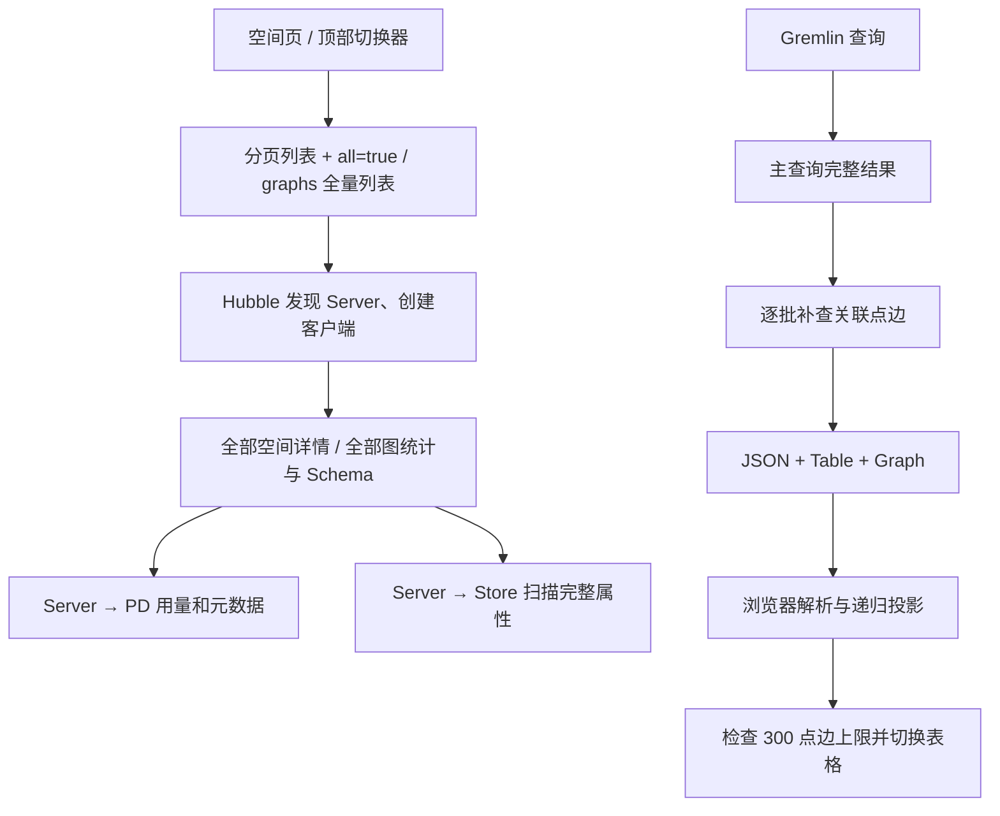

# Hubble / Server / PD 性能根因与改进实施计划

本文记录基于 [本地实测报告](README.md)、运行版本源码及原始调用跟踪的优化前分析和备选方案。当前首版实施范围以本节及 [TODO](TODO.md) 为准，运行验证见 [优化对比](COMPARISON.md)。下文长期接口、预算、工期和指标仍为建议，不代表本轮已实现。

## 用户确认的查询与展示规则（优先于下文早期预算建议）

### 首版范围：保持简单，复用现有功能

用户后续确认大属性也应按可视化需要裁剪。本轮实现 `preview:true` 文本最多 256 字符并注明原长度、大二进制摘要、集合/属性最多 20 项和 4 层深度；JSON/Table/Graph 使用独立预览副本。预览只读且真实数据导入接口拒绝带预览标记的文件，避免将前缀当成原值。完整接口和存储值不变；SDK 到 Hubble 的单属性读取尚未改成统一字节预算。

用户补充要求“尽可能设计简洁一些，别过度设计”。首版只做默认 300 条、画布最多 1000 点、截断提示、限制无效关联补查及按需处理已有视图；空间/图列表优化另行独立交付。

进一步收敛为服务端和前端两道保护：

1. 服务端执行入口统一为未指定有效上限的普通读取设置默认 300 条，并返回是否应用默认限制的提示信息；计数、聚合和写操作保持语义。先在 Hubble 后端执行入口实现，不把所有 HugeGraph Server API 的默认行为一并改掉。
2. 前端在提交前处理常见的显式大结果请求（如 `limit(10000)`），提示并引导使用现有异步执行入口，不先拉取完整结果再截断。复杂语句不依赖前端字符串匹配保证执行安全，服务端仍保留限制。
3. 服务端构造图视图时只处理最多 1000 个唯一顶点及现有边预算内的数据，关联补查也遵守同一范围；前端绘制前再次截断到相同上限并显示部分预览提示。
4. JSON 按需打开，预览有界；超过交互范围的完整数据使用现有异步任务，不另外搭建结果服务，也不自动重跑已经执行过的查询。

复用现有 Gremlin 同步查询及 `GremlinQueryController` 的 `async-task` 接口和任务页面，不新建结果服务、结果存储或通用分页框架。大结果引导用户选择现有异步执行入口，不先同步执行再自动重跑。JSON 预览也必须有界，不能借切换标签一次下载全部大属性结果。

下文新建 result_id/cursor 服务、完整导出体系等保留为后续备选，不属于首版必做项；M3 的完整服务工期不作为本轮交付承诺。只有复用现有能力确实无法满足需求时才单独提出。

- 普通交互式点、边、路径读取未指定有效的结果上限时，默认限制返回 300 条结果，并明确提示“未设置结果上限，本次默认最多返回 300 条”。路径的 300 条结果不等于 300 个唯一顶点，仍须独立应用画布预算。
- 用户明确指定 `limit(10000)` 时保留完整查询意图，但画布最多展示 1000 个唯一顶点，前端截断展示且服务端提前限制图视图的构造、关联补查和返回量。不能先下载完整大结果再仅隐藏多余节点。
- 画布截断时提示“当前为部分图预览，最多展示 1000 个点；大结果请使用异步任务”。实际展示数以返回结果为准，不宣称已知完整结果总数。画布只保留预览顶点之间的边，边数复用现有限制，先不新增一套预算配置。
- JSON/表格按需处理并明确预览状态，大结果复用现有异步任务入口；不能把全部数据换到 JSON 标签后仍一次传给浏览器。视图切换不重执行用户查询，截断画布不冒充完整结果。
- 默认上限不能用字符串搜索 `limit` 或盲目拼接实现：嵌套 `local(limit(...))` 不代表全局上限；聚合、计数、写操作和多语句脚本必须保持执行语义，无法可靠改写时使用有界结果读取或任务模式，不截断聚合输入、不重放写操作。
- 以上是已确认的产品方向；实现与验证状态见 TODO 和优化对比。1000 是画布硬上限，仍需分别验证 300/1000 点和高连边场景，不据此承诺所有拓扑均流畅。

## 1. 判断与优先级

现有问题足以解释“空间一多就加载慢、大属性查询卡顿”。主要存在两类结构性放大：导航/列表把元数据、授权、实时统计和 Schema 串在一起；结果展示把完整查询、关联元素补查、多视图构造与浏览器全量处理串在一起。PD 独立空间用量 RPC 较快，并不代表整个 Server/PD/Store 链路没有性能问题。

| 优先级 | 问题 | 实测或代码证据 | 影响 |
| --- | --- | --- | --- |
| P0 | 空间列表逐个读详情；下拉框请求完整统计 | 1000 空间 1004 次 Server 请求；含数据的 all=true 去 HTTP 代理约 6.92 s | 导航、切换和列表随空间总数增长 |
| P0 | 图列表分页前算全部统计和 Schema | 50 图每页 1 张仍 405 次 Server 请求，其中 300 次 Schema | 缩小 page_size 基本无效 |
| P0 | PD 模式列表统计逐页读取完整点边 | 超过 10000 点仍拉取第 11 页后失败；空间统计为 null | 大属性被多次传输、解析，最后仍无统计 |
| P0 | 关联边补查无全局停止条件 | 12000 点额外 120 次 Gremlin；边限额 500 的复核返回 615 条边 | 同时存在延迟和限额正确性问题 |
| P0 | 超过画布上限仍构建和传送完整视图 | 300 点边保护在前端；大属性 body 303 MB / 路径 498 MB | 保护触发太晚，传输和内存开销已经发生 |
| P1 | 前端全量 JSON 投影和表格本地分页 | 未选 JSON 也先递归遍历；表格拿到全部 rows 才分页；4.42 s 长任务 | 表格降级后仍可能卡住主线程 |
| P1 | 结果补查已有顶点 | 路径中已包含顶点，仍对所有边端点重新取顶点 | 路径查询额外 120 次请求本可避免 |
| P2 | 服务发现/版本探测重复 | 常见每次创建请求客户端有 1–3 次发现及 3 次 versions | 增加固定开销和并发压力，非 N+1 的主要来源 |
| P2 | 250 点画布仍有约 0.6–0.7 s 长任务 | 力导向默认 300 次迭代、enableWorker=false | 需要前端 CPU profile 继续归因 |

先移除无必要的工作，再优化剩余工作的执行效率。单纯扩大线程池、增大超时、升配或上 Helm，都不会消除调用数量和响应体积的放大。

## 2. 调用链与耗时解释



概念上，空间页耗时近似为：发现与探测 + N 次空间详情 + 统计扫描 + Schema 汇总 + 前端处理。每次单调用即使很快，串行乘上 1000 后仍然明显；部署到不同 Pod/节点后，往返延迟还会叠加。

顶点查询近似为：主查询 + ceil(顶点数/100) 次关联边查询 + 多视图处理和序列化 + 浏览器解析。12000 点意味着 120 个装饰查询，即使用户最后只能看表格。

### 从既有原始跟踪进一步拆分

下表由 [call-breakdown.json](call-breakdown.json) 从各采样时间窗关联得到，各列为各自中位数，不能把中位数逐列相加当作某次完整 trace。

| 查询 | 主 Gremlin 等待 | 额外查询数 | 额外查询累计等待 | Hubble 完整响应 |
| --- | ---: | ---: | ---: | ---: |
| 64 B，12000 顶点 | 36 ms | 120 | 609 ms | 791 ms |
| 8 KiB，12000 顶点 | 597 ms | 120 | 19734 ms | 21569 ms |
| 8 KiB，12000 路径 | 1469 ms | 120 | 432 ms | 5048 ms |

大属性顶点查询的补查累计等待约为总耗时的 91.5%（中位数之比）。这是优先消除补查的直接依据。这 19.73 秒包含 Server/Store 执行、响应生成和传输等待，**不能全部归为 Hubble CPU**。路径的 120 次补查是端点顶点补查，顶点查询的 120 次是关联边补查，不能混为一种请求。

### 必须统一的测量口径

补充检查确认：Python 直连 REST 请求会协商 gzip；原 HTTP 跟踪代理剥离 Accept-Encoding，上游返回不压缩数据。因此原报告 Server REST 与跟踪中的 Gremlin 主请求不是同一种压缩、缓存和传输条件，不能相减得到 Hubble 纯开销。原数据仍是真实端到端观测，但不能直接归因于存储扫描。

[protocol-control.json](protocol-control.json) 保存了补充的 identity/gzip 以及去 HTTP 代理的完整顶点查询复核；它独立于原 690 个有效采样，不并入原 P50/P95。后续验收必须固定编码、数据集、协议、缓存和资源状态。

补充复核每组 3 次，均使用保留的大属性图，未修改产品代码：

| 独立复核场景 | 中位耗时 | 说明 |
| --- | ---: | --- |
| Server REST 12000 点，identity | 2.46 s | 解码后 99,156,908 字节 |
| Server REST 12000 点，gzip | 4.95 s | 同一 body，含压缩/传输/客户端解压影响 |
| Hubble 12000 点，Server 不经 HTTP 代理 | 36.98 s | 三次约 48.63 / 36.98 / 36.97 s，body 302,597,361 字节 |

去代理查询三次均返回 12000 个顶点和 615 条边，超过配置的 500 条边限额。它再次确认了性能与限额问题，但不能把 36.98 s 与原 21.57 s 相减作为代理成本：时间、缓存/资源状态和上游编码都不同。这也说明绝对时间验收前必须先固化 M0 基线；压缩在同机 CPU 受限环境并非无代价，不能简单断言“开 gzip 就会更快”。

## 3. 根因到改动的映射

### 3.1 空间选择器和空间管理列表需要不同接口

代码位置：

- [GraphContextSwitcher/index.js:36](../../../hugegraph-hubble/hubble-fe/src/components/GraphContextSwitcher/index.js#L36)：空间使用 all=true，图使用 page_size=-1。
- [GraphSpaceService.java:175](../../../hugegraph-hubble/hubble-be/src/main/java/org/apache/hugegraph/service/space/GraphSpaceService.java#L175)：普通用户逐空间取详情，再逐空间判定权限。
- [GraphSpaceService.java:288](../../../hugegraph-hubble/hubble-be/src/main/java/org/apache/hugegraph/service/space/GraphSpaceService.java#L288)：匿名模式也是名称→全部详情→过滤→分页。
- [GraphSpaceService.java:121](../../../hugegraph-hubble/hubble-be/src/main/java/org/apache/hugegraph/service/space/GraphSpaceService.java#L121)：管理员已使用 profile，当前页再补信息；不能把匿名实测数字直接套到管理员。

Server 的 GraphSpaceAPI.get 每次调用 getSpaceStorage，并获取部门用户信息；GraphManager.getSpaceStorage 每次执行 PD GetGraphSpace。Server 的 `/graphspaces/profile` 标记为 admin，内部仍对每个空间查询用量。把匿名请求直接切到 profile 既不保持权限语义，也没有根除内层循环。

对应 Server 源码：[GraphSpaceAPI](https://github.com/apache/hugegraph/blob/86c05ef9c5d417bd37eab21d4ecd5af82bab17ef/hugegraph-server/hugegraph-api/src/main/java/org/apache/hugegraph/api/space/GraphSpaceAPI.java#L269)、[GraphManager.getSpaceStorage](https://github.com/apache/hugegraph/blob/86c05ef9c5d417bd37eab21d4ecd5af82bab17ef/hugegraph-server/hugegraph-api/src/main/java/org/apache/hugegraph/core/GraphManager.java#L1107)。

改进分两步：

1. Hubble 先提供 opt-in 轻量模式，仅返回 name、nickname 和必要的可见性信息；选择器不再计算统计、管理员列表、Schema。旧 Server 上仍可能需要逐个验证空间，但立即去掉数据扫描这一大块工作。
2. Server 新增受当前身份过滤的 brief/options 能力；从 GraphManager 的元数据构建白名单 DTO，按原有授权规则过滤、搜索和稳定排序后分页。普通列表不访问空间用量和部门凭据。用量在单独接口或后台快照获取，尽量批量读取当前页。

Server 可在内存中扫描/排序元数据，初版未必是 O(1) CPU；关键是远程调用不再是每空间一次，返回体受页大小约束。更大规模可用版本化元数据快照/索引，不能为了宣称 O(1) 省略权限过滤。

建议新增 Hubble 接口（命名待实现时确认）：

```text
GET /api/v1.3/graphspaces/options?query=...&limit=50&cursor=...
GET /api/v1.3/graphspaces/{space}/graphs/options?query=...&limit=50&cursor=...
```

返回 records(name,nickname)、next_cursor、has_more、metadata_revision；total 若提供只能是有权限的总数。当前已选资源需要按名称独立验证或作为 selected 单独返回。

**前端分页不能保留当前的存在性判断**：GraphContextSwitcher 目前用 `list.some(selected)` 判断是否跳转；改成分页后，“不在这一页”不等于“已删除/失权”。只有明确的 403/404 才清理上下文，超时/暂时不可用保留选择并允许重试。

补充前端共用请求缓存/请求合并、200 ms 左右的搜索防抖、AbortController 和切换代次校验。缓存需按部署、会话、空间和查询参数隔离，登录/退出、权限及资源变更失效，禁止把客户端缓存当授权依据。当前 cancelled 布尔值只防止旧结果写入，不等于取消后端工作。

### 3.2 图列表先筛选、排序、分页，再做当前页的补充

[GraphsService.java:141](../../../hugegraph-hubble/hubble-be/src/main/java/org/apache/hugegraph/service/graphs/GraphsService.java#L141) 先 sortedGraphsProfile（内部逐图 evCount），再对全部结果执行 getSchemaView，最后 PageUtil.page。查询创建时间的过滤也发生在统计之后。

[SchemaService.java:94](../../../hugegraph-hubble/hubble-be/src/main/java/org/apache/hugegraph/service/schema/SchemaService.java#L94) 依赖完整 PropertyKey、VertexLabel、EdgeLabel 服务；VertexLabel 额外取 IndexLabel，EdgeLabel 重复取 EdgeLabel 并再取 IndexLabel，所以空图也出现每图 6 次 Schema 请求。这是“摘要需要完整管理模型”的放大。

改动：拆成纯 metadata、可选 statistics、可选 schemaSummary 三层。列表默认 metadata，筛选和排序后立即分页；只有当前页或展开的卡片才请求附加字段。图选择器直接用受权限过滤的图简表，保留昵称和默认图语义。

Schema 摘要按确切需要的字段生成；能使用单次 schema 快照时一次取回，不借用需要完整索引/父子转换的管理服务。缓存按部署、space、graph incarnation、schema revision 隔离，Schema 修改后失效；不缓存未过滤的授权结果。局部摘要失败返回明确 unavailable，基础列表照常可用。

### 3.3 统计从导航关键路径移除

[GraphsService.java:804](../../../hugegraph-hubble/hubble-be/src/main/java/org/apache/hugegraph/service/graphs/GraphsService.java#L804) 在 PD 模式跳过已有统计读取，直接走 [postSmallGraphStatistics:660](../../../hugegraph-hubble/hubble-be/src/main/java/org/apache/hugegraph/service/graphs/GraphsService.java#L660)。它读取带完整属性的点/边页，取到第 10001 个元素才报错；第 11 页可能已传了 1000 条。顶点超限后边计数也不再执行，两项都返回 null。

改动：

- 导航和默认列表不触发完整计数；用户进入统计区才请求缓存或异步刷新。
- 输出 value、status、exact、source、observed_at；未计算、计算中、过期、不可用要区分，不能用 0 或今天的日期冒充成功统计。
- 先核对 Server 1.8/hstore 真正支持的统计能力，再选择元数据统计或后台聚合。PD 空间用量是存储用量，不能当作点边数量。
- 现有 `g.V().count()` / `g.E().count()` 至少避免把全部属性搬到 Hubble；大图计数仍可能扫描，不能无条件同步执行，也不能把 count 改写成本地分页扫描。
- 同图刷新合并为一个任务，设置全局并发/队列/时间预算；已超预算或不支持的结果负缓存，避免每次导航重新失败。数据/Schema/权限变更分别失效，不把授权失效延后到普通 TTL。
- 统计任务完成后读取结果仍重新授权。空间聚合中有未知子图就保留 partial/unknown，不把未知相加成 0。

建议初始统计 TTL 30–60 s、已知不可用冷却更长并允许显式刷新；这是待压测调参的初值，不是精确计数的新鲜度承诺。

### 3.4 修复关联补查的停止条件，并按展示需要决定是否补查

[QueryService.java:634](../../../hugegraph-hubble/hubble-be/src/main/java/org/apache/hugegraph/service/query/QueryService.java#L634) 外层是 partition.forEach，break 只退出当前批次内的结果循环。达到 edgeLimit 后，下一个批次仍请求并插入至少一条边，因此不仅浪费 120 次请求，还可突破上限。

P0 修复：

- 改为可终止的外层循环，发请求前检查剩余额度；用剩余额度约束查询和收集，去重后计数，满足全局上限就结束。
- 节点度数在整个请求内统一计数，不在每批重置；达到某节点度数时跳过不合法边，而不是终止其他节点所在的整批。自环/重边按既有业务定义验证。
- 表格/JSON 视图不做纯展示装饰；已超过画布预算的结果不启动关联补查。
- PATH/EDGE 情况先计算缺失端点集合。当前 [buildGraphView:526](../../../hugegraph-hubble/hubble-be/src/main/java/org/apache/hugegraph/service/query/QueryService.java#L526) 即使已有顶点也读取全部端点；新逻辑只补缺失项，避免覆盖主查询已经返回的顶点。
- 保留主查询顺序、重复行、路径顺序和原始值；装饰失败或预算耗尽必须有状态说明，不静默丢数据，也不扩大查询权限。

仅把 batch_query_ids 从 100 调大可能减少 RTT，但不保证节点度数、总边数、Server 查询复杂度和响应预算，也不会消除不需要的查询，因此不作为主修复。

### 3.5 结果交付与视图构造分离

[QueryService.java:111](../../../hugegraph-hubble/hubble-be/src/main/java/org/apache/hugegraph/service/query/QueryService.java#L111) 无条件执行 parseResults、JsonView、TableView、GraphView。TableView 对顶点又包含 properties；在网络 JSON 中同一属性会多次序列化。共享 Java 对象引用并不等于线上只传一次，也不能据此断言堆内存恰好放大三倍。

P0 先给 Hubble 查询请求增加 opt-in 视图和装饰选项，前端只请求当前需要的视图。按上文确认的规则生成最多 1000 个顶点的局部图预览，提前限制关联补查、边数及属性字节；超过预算的部分不构造、不传给画布，并明确标记部分结果。保留旧调用契约的兼容路径并单独监测，不能在老客户端请求上静默把完整结果改成预览。

P1 建立“执行一次、按需读取”的结果服务：

```text
POST .../queries                     -> result_id / status / bounded preview
GET  .../query-results/{id}/rows      -> cursor + bounded rows
GET  .../query-results/{id}/graph     -> bounded topology / property projection
GET  .../query-results/{id}/values/... -> selected complete property or bounded value page
POST .../query-results/{id}/export   -> complete downloadable result
DELETE .../query-results/{id}         -> cancel/release when supported
```

交互预算：未指定上限的普通读取默认 300 条，画布硬上限 1000 个唯一顶点；每页 100 行、单响应解码后不超过 2 MiB 仍为建议，边数单独设限并验证。属性显示短预览，完整值按需读取。超预算要明确 has_more / truncated / omitted_properties 及获取完整数据的方式，不能显示“完整结果”却只给前 100 行。很大的单一属性走有界读取/文件下载，不能靠无限放宽页大小。

结果需存放在有 TTL、总字节和并发任务配额的受管存储，内存不能无限持有完整结果。现有 SDK 的完整 JSON 物化仍然限制上游内存；要实现真正有界的完整结果/导出，需要同步评估 Server 与 SDK 的流式读取或受管任务结果能力，不能只把 Controller 换成 StreamingResponseBody 就声称解决。

**不得用 offset 重执行任意 Gremlin 来“分页”**：查询可能带写操作、时间变化、不稳定排序或昂贵计算。任意查询应执行一次并对结果做快照/物化分页；普通数据浏览可走存储 page cursor，但这是不同的用户操作。切换视图读取同一个 result_id，不能重放查询。

结果标识必须绑定身份、部署、空间、图及创建代次；每次读取、取消和导出都重新校验授权。跨视图保留 BigInt/大整数 ID、Map、Path、自环和重边语义；不能因为改用原生 JSON.parse 或字符串化而破坏数值精度。

压缩在减少数据后再调。保留 Accept-Encoding 协商和 Vary；小/不可压缩体不盲目压缩。同机 CPU 受限和跨节点带宽受限可能需要不同阈值，需对 identity/gzip 分别测 CPU、线上字节和延迟。

### 3.6 前端在分页和预算内处理数据

[QueryResult/Home/index.js:101](../../../hugegraph-hubble/hubble-fe/src/modules/analysis/QueryResult/Home/index.js#L101) 不论选哪个标签都先 getJsonViewContent；[utils.js:26](../../../hugegraph-hubble/hubble-fe/src/modules/analysis/QueryResult/Home/utils.js#L26) 递归复制对象/数组。预览函数还先 projectJsonValue 全部 rows，再 slice 前 3 行；字符限制在 stringify 之后生效。预览不是有界工作的实现。

[TableView/index.js:127](../../../hugegraph-hubble/hubble-fe/src/modules/analysis/QueryResult/TableView/index.js#L127) 使用全量 rows 做 Ant Design 本地分页，限制的是 DOM 页数，没限制已下载和解析的数据。

改动：按激活视图懒计算；预览先截行数，再按字段/深度/字符预算投影，不能先序列化整份数据；表格由服务端结果 cursor 驱动。JSON 大结果采用增量/有界展示，后台导出不在主线程 stringify 全部数据。Worker 处理仍要遵守字节预算，不能把无界数据换个线程复制。

当前实现的 300 点/300 边超限后切换表格，应按上文规则改为最多 1000 点的局部图预览，并把预算前移到服务端；前端保留同样的防御性截断。250 点的长任务还需 Chrome profile 区分布局、G6 图形创建、数据投影和 GC，并增加 1000 点验证。代码中力导向 300 次迭代、enableWorker=false 是调查线索，不是已证明的唯一原因。若迁移布局到 Worker，需要纯数据输入/输出并验证自定义 pinned layout、固定节点、历史记录和取消语义，不能只翻转一个开关。

“直接绘制 12000 点 + 12000 边”应另立能力项目：分层展示/聚合、LOD、按视口加载、标签简化、Worker 布局、画布对象外置属性，完成专门交互压测后再调整默认限制。不能简单删除 300 限制作为本次优化交付。

### 3.7 PD 发现、版本探测和连接生命周期

[HugeClientPoolService.java:141](../../../hugegraph-hubble/hubble-be/src/main/java/org/apache/hugegraph/service/HugeClientPoolService.java#L141) 实际创建请求级客户端；[allAvailableURLs:228](../../../hugegraph-hubble/hubble-be/src/main/java/org/apache/hugegraph/service/HugeClientPoolService.java#L228) 每次先实时发现，现有 URL 缓存主要在失败时回退。图上下文最多做 graph/service、graphspace、DEFAULT 三次发现。

[HugeClient.java:214](../../../hugegraph-client/src/main/java/org/apache/hugegraph/driver/HugeClient.java#L214) 分别读取 API 和 core 版本；[VersionManager.java:32](../../../hugegraph-client/src/main/java/org/apache/hugegraph/driver/VersionManager.java#L32) 每次读取都 versionAPI.get；Pool 在 tryConnect 成功后又读一次版本，解释常见 3 次 versions。这是固定开销；一个查询内的 120 次 Gremlin 并不等于创建了 120 个 HugeClient。

先在一次握手中获取一个 Versions 快照，复用 API/core 信息并移除重复成功探测。再评估 2–5 s 的发现正缓存、按 key 合并刷新和故障失效；保持 PD 发现地址权威、默认服务回退优先级、401/403 不回退、不自动重放业务请求。

不把 mutable HugeClient 全局共享：BaseController 和统计代码都会 assignGraph，直接 parallelStream 或多用户共用会引入空间/图/令牌串用。需要复用时，复用可明确隔离的底层连接池/不可变版本元数据，保留请求级授权和图上下文；TLS、超时、认证方式不同的 transport 不能混用。并发统计必须每任务独立上下文，并受全局限额约束。

## 4. 分阶段交付与依赖

以下为单人有效开发人日粗估，不含跨仓评审/发布等待；完成第一阶段后依据 profile 重估，总体约 15–25 人日。

| 阶段 | 预估 | 交付 | 依赖与完成门槛 |
| --- | --- | --- | --- |
| M0：固化基线 | 1–2 日 | 无代理主基线；同编码采样；阶段计时、JFR/Chrome profile；三种身份 | 数据集/图数/缓存/资源状态固定，统计返回与总数可核验 |
| M1：Hubble 快速修复 | 3–5 日 | 选择器不算统计；图列表先分页；全局边上限；缺失端点补查；大图禁装饰；懒 JSON/有界预览；握手去重 | 常用 UI 不再全量统计；超过画布预算的请求补查数为 0；旧 API 行为有兼容测试 |
| M2：Server/SDK 元数据简表 | 3–5 日 | 受权限过滤的 brief/options；Server 不逐行取用量；SDK 能力适配；前端 cursor 搜索 | M1；匿名与普通用户不能借用管理员 profile；页面负载不随图属性大小增长 |
| M3：有界结果交付 | 5–8 日 | result_id、结果分页/投影、完整导出、上游流式/任务结果、TTL/取消/预算 | M1；涉及 Server/SDK 时配套发布；执行一次、换视图不重放 |
| M4：连接与交互回归 | 2–4 日 | 发现缓存/失效、可隔离 transport 复用、布局优化、并发/故障/兼容回归 | M0–M3；身份切换和故障无回放；通过本地门槛后才 Helm |

建议拆成可独立审查的变更：①列表与统计拆分；②查询装饰限额和缺失端点；③前端懒处理；④Server+SDK brief 契约；⑤结果服务与导出；⑥发现/连接及最终性能回归。Server 新能力需要两仓代码、文档、SDK 版本与集成验证，不能只合 Hubble 一侧。

M1 不承诺完全去掉旧 Server 匿名路径的 N 次详情；这是 M2 的跨仓目标。M1 也不能保证上游不再物化 100 MB；这是 M3 必须验收的内容。阶段完成不能把后续能力记作已经实现。

## 5. 验收指标：硬性工作量预算 + 待验证延迟目标

以下目标固定在原 4 vCPU / 16 GiB、1 PD + 1 Store + 1 hstore Server 的环境；热态主基线不加 HTTP 跟踪代理，冷启动另报。时间目标不是当前已实现的成绩。

| 项目 | 硬性门槛 | 建议性能目标 |
| --- | --- | --- |
| 1000 空间选择器 | 无点边扫描、无 Schema 请求；M2 每页远程请求数与空间总数无关 | M1 P95 ≤1.5 s；M2 P95 ≤300 ms |
| 50 图、page_size=1 | 不计算其余 49 图的统计/Schema；M1 单图 Schema 请求≤6，M2 简表为0 | 基础列表 P95 ≤200 ms；单图详情独立测 |
| 含大属性图的导航 | all=true 全量统计不出现在导航关键路径；一次用户导航的重复请求合并 | 导航内容可用≤1 s，未完成统计不阻塞 |
| 12000 点查询 | 画布超限则关联补查=0；请求启用画布时全局边数始终≤配置值 | 同协议/缓存下额外加工耗时单独计；先争取消除大部分补查等待，不拿原21.57 s直接承诺新绝对值 |
| 12000 路径 | 已有全部端点时补查=0；路径和数值语义完整 | 主查询/下载与结果加工分别报告 |
| M3 表格/图预览 | 未指定上限默认300条；画布≤1000唯一顶点，边独立设限；建议单响应≤2 MiB、每页100行；完整数据可导出；未取属性不传输 | 结果就绪后分页 API P95≤300 ms，首屏展示≤1 s；1000点需补交互验证 |
| 浏览器 | 不全量投影未激活视图；长任务记录完整 | 常用250点及分页表格最长任务争取≤200 ms；大导出不阻塞主线程 |
| 内存/故障 | 并发结果和后台刷新有硬预算；取消后资源释放；无OOM/权限泄漏/业务回放 | 重复查询后占用回落，RSS/GC/PSI与存储吞吐单列 |

复杂 Gremlin 的执行时间和完整 200 MB 级导出的传输时间，不受“结果就绪后分页 API”目标约束；必须单独展示。统计新鲜度与精确性也不能靠降低质量偷偷换取指标。

## 6. 验证矩阵与观测

回归使用与基线一致的伪随机数据和固定资源；不要在测试途中改变图数量/属性/压缩，再将差值全归因于某个改动。

- 身份：匿名、系统管理员、空间管理员、analyst/observer、只读普通用户；混合公开/私有空间、部分图授权、撤权与退出。
- 数量：1/10/100/500/1000 空间；1/10/50/100 图；1000/12000/50000 点边；64 B/8 KiB/64 KiB 属性；环、高度数枢纽、重边、自环、孤立点。
- 结果：Vertex/Edge/Path/Map/聚合值；大整数、日期、空值、多语句和带写操作查询；用户明确请求完整数据时校验不丢行、不重放。
- 边界：预算前后1条、重复边占位、全局/每节点限额、缺失端点、空页、Schema 更新、图删除同名重建、旧响应晚于新选择。
- 并发/故障：单用户及5/10并发用户；冷/热缓存；PD不可达、发现地址变化、Server重启、401/403、Store慢响应、客户端取消。URL 缓存不能把权限错误伪装成网络重试。
- 版本：1.8/master 完整契约；1.7 通过 SDK/resolver 薄适配保底；1.5 standalone 不提供 GraphSpace/PD 能力。版本判断不散落到 Controller/React 页面。

补充埋点覆盖：Hubble resolve/handshake/main_query/parse/enrich/view_build/serialize；Server query/scan/JSON/gzip；Store RPC与PD方法耗时；浏览器 resource/JSON处理/表格/布局/longtask。记录调用数、解码/线上字节、行数、缓存命中、队列、GC、CPU、RSS、内存压力。原有长任务证明发生卡顿，但未提供函数级 CPU 归因，需 Chrome profile；Server/Store 也需 JFR/调用栈后再决定是否改扫描/序列化实现。

常规接口每场景至少30个有效样本；重负载场景预算内尽量达到20个。报告 P50/P95、最大值、错误率、冷启动和测量不确定性。指标只用归一化路由和方法作低基数标签；不把原始 Gremlin、属性值、口令和令牌写日志。请求级跟踪可采样关联场景，减少跟踪本身的扰动。

关键自动回归必须断言“没做多余工作”：selector 无扫描；分页只补当前页；同一结果不重执行；超限不发装饰查询；edgeLimit 永不突破；PATH 已有端点不补查。只测 HTTP 200 或方法返回值不够。UI 改动按仓库要求在 Chrome 验证登录/匿名、连接切换、权限和空间可见性，并保存截图。

## 7. 发布与 Helm

用 opt-in 轻量/有界契约分步迁移，先在本地同一数据集验证，再在测试环境逐步放量。新 brief 能力不可用时走明示、受限的兼容路径；401/403 不视作“不支持”降级。必要的回滚开关只切换兼容路径，不应重新开启无界刷新或自动重放查询。

进入 Helm 的门槛：M1 的结构性问题消除、M2 主要元数据链路达标、M3 大结果有界或有明确完整导出路径、身份与故障矩阵通过。届时固定官方 Chart/镜像版本和资源 requests/limits，再测跨 Pod RTT、压缩、服务发现故障恢复、存储卷与资源压力。Helm 是后续部署验证，不是本次逻辑问题的解决办法。
