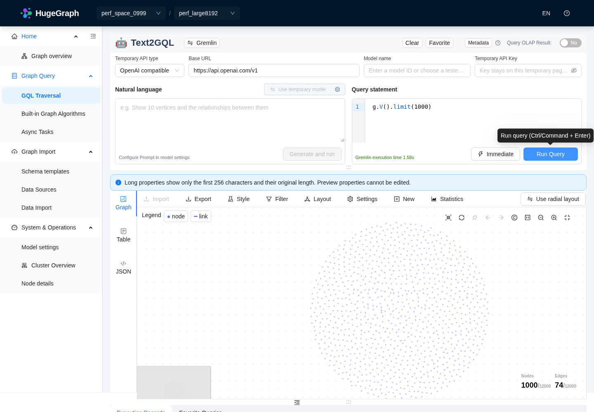
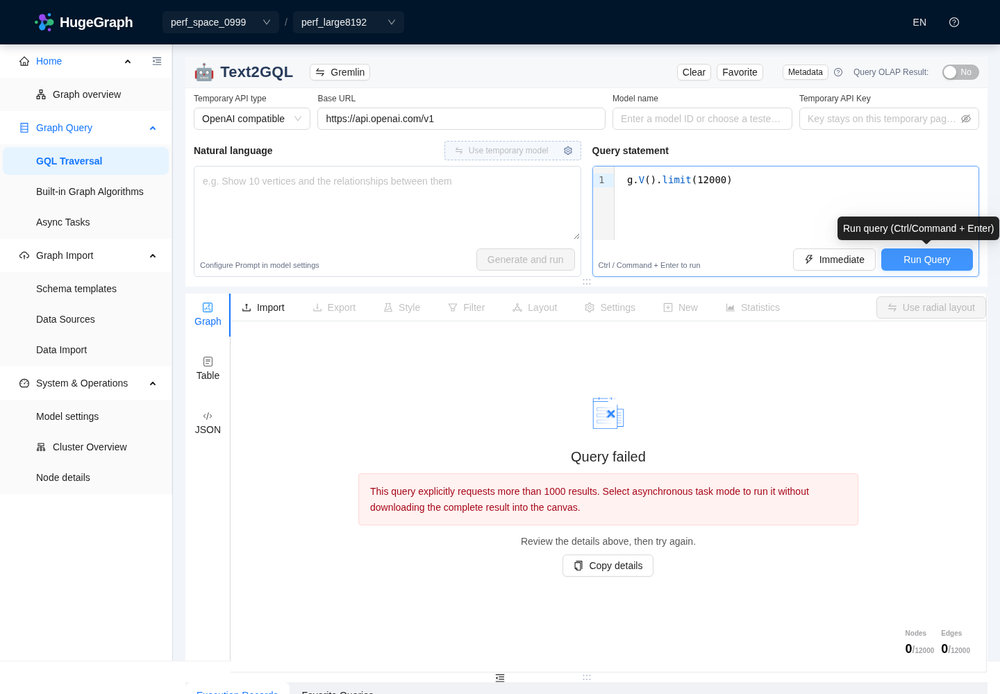
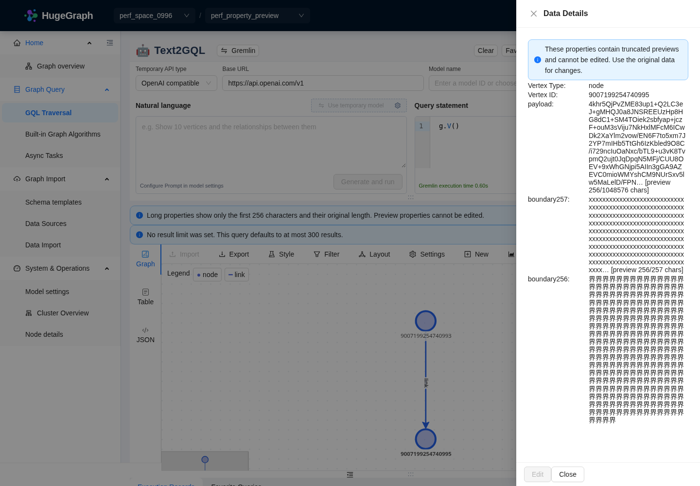

# 本地优化前后对比

本轮在相同的本地 PD + HStore + Server 上复测了 1000 个空间、50 张空图，以及两张各含 **12000 点 / 12000 边**的数据图。属性分别为 64 B、8192 B，沿用此前的确定性伪随机数据，没有重新导入。

主要收益是图列表按当前页计算、导航改为精简元数据、交互预览提前限制上游结果，减少默认布局迭代，以及将交互预览中的超长属性限制为256字符。空间名称的逐项详情读取仍然存在；小结果没有普遍提速，1000 点仍有可感知主线程阻塞。复测还修正了上游预览限制、分析页切换器等遗漏，并单独修复和验证了 Server 异步结果压缩扩容问题。

## 测量口径

- API 统一 `Accept-Encoding: identity`，通过 PD 发现后直连 Server `18080`；没有 HTTP 跟踪代理。耗时包含接收完整响应，不包含 Python JSON 解析或浏览器绘制。Hubble 到 Server 的 SDK 协议保持一致，没有通过调整全局超时或编码制造收益。
- 主要对比在构建、单测及浏览器任务暂停后的独立窗口进行。每场景预热 1 次，再串行采样 5 次；全空间统计采样 3 次。匹配的 13 个场景共 126 次正式采样，另有两个新精简接口的 10 次采样；均成功。P95 用最近秩法，少量样本不能代表稳定 SLA。
- 显式 `limit(300)`、`limit(1000)` 保持主查询结果条数相同。路径的图预览现在遵守 1000 点 / 500 边预算，因此完整 JSON 行数相同，Graph 子视图较小。默认查询 250→300、导航全量统计→精简元数据、画布超限切表格→最多1000点预览属于产品行为变化，单独报告。
- API 匹配窗口的 `preview:false` 路径与最终代码一致；其后的上游预览补丁只影响 `preview:true`，用独立的 18 项执行断言验证。Hubble 的 API、浏览器及布局采样均在 Server 压缩补充修复部署前完成，Server 保持 `86c05ef9c5d417bd37eab21d4ecd5af82bab17ef`。
- 随后的超长属性阶段另建2点1边专用图，包含100 KiB / 1 MiB属性、256/257字符边界及大整数ID；总图数55→56，1000空间、50图列表和两张12000点边图保持不变。新增图发生在匹配元数据采样之后。属性阶段另做6场景、各1次预热+5次采样；原始与裁剪属性夹具只比较体积与完整性，原始阶段有构建负载，不比较延迟。
- 本地原配置显式写了 `gremlin.suffix_limit=250`，升级运行配置改为 300，与此次代码及分发默认值一致。未复制其他运行配置、密钥或数据库。
- 初期开发负载窗口的 12000 点大属性请求为 40.90 秒预热、68.85 / 63.09 秒两次完整样本；随后中止剩余采样。它们不用于计算提速倍数。原始历史报告中的代理和压缩差异说明仍有效。

## API：相同主查询结果量的完整对照

下表为 P50 / P95，单位 ms；体积为解码后字节数。变化为 P50，新值比旧值增加标为 `+`。

| 场景 | 优化前 P50 / P95 | 优化后 P50 / P95 | P50变化 | 旧 / 新响应字节 |
| --- | ---: | ---: | ---: | ---: |
| 空间名称列表，1000空间 | 701.92 / 742.41 | 832.92 / 1131.28 | +18.7% | 18,064 / 18,064 |
| 空间列表，每页10个 | 727.17 / 773.20 | 760.00 / 805.29 | +4.5% | 6,960 / 6,960 |
| 旧全空间及统计接口 | 8248.08 / 8484.61 | 8044.24 / 8506.25 | -2.5% | 675,148 / 675,148 |
| 50图列表，每页1张 | 267.73 / 407.32 | 35.70 / 52.39 | -86.7% | 823 / 823 |
| 50图列表，每页10张 | 230.88 / 257.31 | 87.79 / 126.87 | -62.0% | 7,231 / 7,231 |
| 64 B，300点 | 54.65 / 62.78 | 63.28 / 69.38 | +15.8% | 126,158 / 126,341 |
| 64 B，1000点 | 99.33 / 116.14 | 125.00 / 139.62 | +25.8% | 420,947 / 421,130 |
| 64 B，1000条路径 | 112.74 / 133.25 | 86.70 / 150.50 | -23.1% | 997,282 / 753,970 |
| 64 B，点计数 | 24.46 / 27.34 | 31.90 / 39.36 | +30.4% | 238 / 421 |
| 8 KiB，300点 | 632.83 / 684.77 | 593.61 / 622.03 | -6.2% | 7,612,046 / 7,612,229 |
| 8 KiB，1000点 | 1474.12 / 1662.53 | 1521.27 / 1601.70 | +3.2% | 25,406,419 / 25,406,602 |
| 8 KiB，1000条路径 | 2365.69 / 2440.05 | 1416.48 / 1565.36 | -40.1% | 49,163,810 / 37,329,970 |
| 8 KiB，点计数 | 257.92 / 273.87 | 256.82 / 292.67 | -0.4% | 238 / 421 |

图列表每页1张从 **267.73→35.70 ms（降低86.7%）**，每页10张降低62.0%；大属性1000路径从 **2365.69→1416.48 ms（降低40.1%）**，响应从49.16 MB降到37.33 MB。空间名称列表和旧 `all=true` 接口没有获得结构性改善；不能把表中所有场景描述为提速。

小属性的初次优化后采样出现300点增加8.63 ms、1000点增加25.67 ms。为检查热身影响，在 Server 补充修复部署前，对相同 Hubble 进程另做每场景10次预热、10次采样：

| 64 B 场景 | 原基线P50 / P95 | 初次优化后 | 加强预热后P50 / P95 |
| --- | ---: | ---: | ---: |
| 300点 | 54.65 / 62.78 | 63.28 / 69.38 | 52.17 / 56.77 |
| 1000点 | 99.33 / 116.14 | 125.00 / 139.62 | 111.60 / 124.76 |

300点的初次退化在加强预热后消失；1000点仍比原基线慢约 **12.27 ms**。这个复核不是新的成对基线，不能据此证明全部差异来自 JIT，也不能用它替换最初的对照结果。

## 导航：只加载切换器需要的信息

新增接口分别为：

- `graphspaces?brief=true&page_no=1&page_size=-1`：P50 / P95 **712.69 / 766.66 ms**，56107字节。
- `graphspaces/perf_space_0997/graphs?brief=true&page_no=1&page_size=-1`：50图，**19.30 / 23.99 ms**，2711字节。

旧顶部空间切换器使用 `all=true`，本轮P50为8248.08 ms、675148字节。改用精简接口后，同一导航所需请求降低约 **91.4%等待、91.7%体积**；这是取消统计工作的收益，不是相同完整统计接口的纯加速。

浏览器第一次复测发现：全局切换器已经改为精简接口，分析页 `TopBar` 仍调用旧 `graphs/list`，大属性空间该请求约5.79秒，导航仍需10.68秒。继续修复该调用后，最终页面导航结果如下。这里截止到页面资源空闲，是单次 Chromium 观测，不是P50。

| 页面 | 优化前 | 最终优化后 |
| --- | ---: | ---: |
| 64 B图查询页 | 10.68 s | 2.89 s |
| 8 KiB图查询页 | 12.79 s | 3.33 s |

匿名模式的空间精简接口仍需逐项读取详情以保持昵称、可见性及现有权限语义；1000空间仍约0.7秒。要继续消除随空间数增长的远程调用，需要后续 Server 授权元数据接口。此次未使用管理员专用接口绕过权限。

## 查询限制和真实浏览器结果

最终18项执行记录覆盖两张图，验证：

- 未指定上限的普通Gremlin读取返回300条，`default_limit_applied=true`；界面显示默认限制提示。
- 显式1000点返回1000个唯一画布顶点；关联边和路径预览始终≤500条，边端点均存在于预览顶点中。
- `preview:true` 的12000点和12000路径只返回1000条预览，包含截断标记；没有将预览数量当作完整结果总数。
- `g.V().count()` 仍为12000，不被默认限制改写；无匹配对象的 `drop()` 保持成功且不应用读取默认上限。最终两图点、边计数仍各为12000。
- 两张图手动输入 `g.V().limit(12000)`，提交前拦截后新增查询POST数均为 **0**。用户主动选择现有异步模式后，小属性任务成功提交；没有先同步执行再自动重跑。

第一次仅在SDK取回完整结果后截断，8 KiB / 12000路径仍在Server输出压缩响应时中断，Hubble返回`source exhausted prematurely`。继续将可识别的只读预览上限前移到上游，最多取1001条以判断是否还有结果，再返回前1000条；保持聚合、写操作和旧客户端完整查询路径。修复后该用例成功：

| 最终交互预览，单次断言 | 响应耗时 | 响应字节 | 预览行 / 点 / 边 |
| --- | ---: | ---: | ---: |
| 64 B，12000点 | 76.67 ms | 407857 | 1000 / 1000 / 0 |
| 64 B，12000路径 | 212.89 ms | 754030 | 1000 / 1000 / 500 |
| 8 KiB，12000点 | 656.83 ms | 1067856 | 1000 / 1000 / 0 |
| 8 KiB，12000路径 | 1431.21 ms | 1744029 | 1000 / 1000 / 500 |

这些是有界预览，不能与旧的完整12000条响应相减作为纯计算提速，也不等于已经完成完整导出。

最终Chrome复测8个查询用例均得到预期画布/表格状态，页面异常为0；登录页在匿名模式重定向，账户入口隐藏，空间0997及图`perf_meta_001`的实际选择和路由切换通过。具有真实登录凭据的管理员/普通用户环境没有部署；权限分支由单测覆盖，本轮结果不替代真实鉴权环境集成验证。

| 最终Chrome查询 | 结果可用时间 | 最长主线程任务 | 实际画布 |
| --- | ---: | ---: | --- |
| 64 B，默认读取 | 0.86 s | 580 ms | 300点 / 21边 |
| 64 B，1000点 | 1.05 s | 673 ms | 1000点 / 74边 |
| 64 B，1000路径 | 1.32 s | 924 ms | 1000点 / 500边 |
| 8 KiB，默认读取 | 1.59 s | 676 ms | 300点 / 21边 |
| 8 KiB，1000点 | 2.48 s | 702 ms | 1000点 / 74边 |
| 8 KiB，1000路径 | 2.74 s | 919 ms | 1000点 / 500边 |

1000点能展示，仍有可感知阻塞，**没有达到≤200 ms长任务目标**。初始1000点布局出现约1.8–2.1秒长任务后，CPU采样定位到同步布局：同一个1000点/74边场景，`graphLayout`后代采样时间1159.48→285.13 ms，`tick`1146.39→268.02 ms。仅调整默认迭代次数，保留用户显式布局参数；该剖析中整体结果可用时间1972.22→1569.22 ms，不能把75.4%的布局采样下降当作整体提速。最终截图确认1000点分布及关系预览正常；固定点和自定义布局由已有运行时测试验证。





## 超长属性：传输前裁剪，预览只读

`preview:true` 对 Graph、Table 和 JSON 中的长字符串返回前256字符和原始字符数，根字段标明`properties_truncated`及`property_preview_limit=256`。IDs、标签和端点不做此裁剪；旧的完整查询路径保持兼容。截断数据来自脱离原对象的预览副本。

新增夹具中，2个点分别包含100 KiB、1 MiB属性，1条边含1 MiB属性。实际响应如下；这是固定内容的体积对照，不能视为延迟基线。

| 查询 | 裁剪前字节 | 裁剪后字节 |
| --- | ---: | ---: |
| vertices | 4,509,209 | 9,924 |
| edges | 4,300,211 | 5,050 |
| paths | 4,404,821 | 7,598 |
| scalar | 2,097,569 | 1,048 |
| ids | 490 | 548 |
| count | 416 | 474 |

256个汉字完整保留，257字符值被裁剪；两个大整数ID`9007199254740993`、`9007199254740995`及边端点保持精确。点、边原始属性通过直接Server GET核对长度和SHA256，裁剪前后均不变。实际Chrome打开1 MiB点的详情，能看到原始长度；Edit按钮禁用，物理点击没有发出PUT/PATCH。JSON同样仅展示有界预览。导出的预览保留只读标记；这不是完整数据导出。

实际数据库导入接口也做负向验证：提交仅有预览标记、没有ID/标签的安全夹具，HTTP400明确返回`A truncated preview cannot be imported as full graph data`，原始点SHA256不变。前端导出/载入适配器的往返单测不替代这项真实导入接口验证。

同一最终Hubble进程，属性预览开启后再采样5次：

| 交互预览 | P50 / P95 ms | 响应字节 |
| --- | ---: | ---: |
| 64 B，默认300点 | 61.32 / 68.67 | 126,401 |
| 64 B，1000点 | 111.75 / 186.41 | 421,191 |
| 64 B，1000路径 | 94.00 / 98.10 | 754,031 |
| 8 KiB，默认300点 | 564.35 / 618.43 | 329,020 |
| 8 KiB，1000点 | 1431.34 / 1568.30 | 1,097,470 |
| 8 KiB，1000路径 | 1399.29 / 1452.70 | 1,744,030 |

8 KiB的1000点响应从未裁剪属性阶段25.41 MB降至1.10 MB，1000路径从37.33 MB降至1.74 MB。以上实测ASCII数据的预览均小于2 MiB；没有实现任意结果的总字节硬上限。上游SDK仍会读取有界行数内的完整属性，因此传输体积大降不代表执行耗时同比下降。



## 异步任务的既有Server限制与补充发现

小属性12000点任务成功。大属性相同语句的任务在 **126.471秒后失败**，错误为：

```text
Task result size 99665305 exceeded limit 16777216 bytes
```

Server默认任务结果上限为压缩后16 MiB；异步执行不等于可以无限保存完整大结果。本轮没有调大该限制。用户应减少返回行数或按需选择属性；完整大结果导出仍需遵循Server能力和容量限制。

采样时任务线程已经消耗60.9秒CPU，栈位于 `HugeTask.checkPropertySize → StringEncoding.compress → LZ4Util.compress → org.apache.hugegraph.serializer.BytesBuffer.require → ByteBuffer.allocate`。核对实际JAR为`hugegraph-struct-1.8.0.jar`中的Struct类，不是Server包内另一个同名实现。

原代码先用输入长度/1.5分配压缩缓冲区；不可压缩结果超过初始容量后，按`requiredCapacity + 64`分配并复制旧缓冲区，每个4 KiB压缩块都可能触发复制。此工作发生在16 MiB大小检查之前，解释了结果最终被拒绝却消耗大量CPU的现象。

对应原始Server源码：[任务结果上限](https://github.com/apache/hugegraph/blob/86c05ef9c5d417bd37eab21d4ecd5af82bab17ef/hugegraph-server/hugegraph-core/src/main/java/org/apache/hugegraph/config/CoreOptions.java#L302)、[大小检查](https://github.com/apache/hugegraph/blob/86c05ef9c5d417bd37eab21d4ecd5af82bab17ef/hugegraph-server/hugegraph-core/src/main/java/org/apache/hugegraph/task/HugeTask.java#L800)、[LZ4初始容量](https://github.com/apache/hugegraph/blob/86c05ef9c5d417bd37eab21d4ecd5af82bab17ef/hugegraph-struct/src/main/java/org/apache/hugegraph/util/LZ4Util.java#L40)、[Struct扩容](https://github.com/apache/hugegraph/blob/86c05ef9c5d417bd37eab21d4ecd5af82bab17ef/hugegraph-struct/src/main/java/org/apache/hugegraph/serializer/BytesBuffer.java#L213)。

该Server补充修复单独验证，不混入前述Hubble对照窗口。8 MiB随机输入微基准中，相同压缩输出8431637字节且摘要一致；扩容次数690→1，累计复制4836342825→5590886字节，压缩中位耗时696.756→11.064 ms。Struct模块136项测试通过。实际Server仅替换该Struct补丁JAR后，同一8 KiB / 12000点语句的任务10001在 **1.600秒** 后到达相同16 MiB上限，错误大小仍为99665305字节；原任务为126.471秒。前次运行存在开发负载，这两次不是严格成对吞吐基准；配对微基准及相同拒绝结果支持扩容修复的因果判断。结果容量未扩大，超限完整任务依然失败。部署清单和类差异单独留档：173个类中169个字节相同，另3个嵌套类仅调试偏移变化，反汇编逻辑相同。

## 证据、复现与边界

- [优化前采样](comparison/before-samples.jsonl.gz)、[优化后采样](comparison/after-samples.jsonl.gz)、[优化前汇总](comparison/before-summary.jsonl)、[优化后汇总](comparison/after-summary.jsonl)、[加强预热复核](comparison/after-warm-small-summary.jsonl)。
- [最终预览断言](comparison/preview-assertions.json)、[浏览器优化前](comparison/browser-before.jsonl)、[浏览器最终结果](comparison/browser-after.jsonl)、[运行出处与配置差异](comparison/provenance.json)。
- [布局原始CPU采样：优化前](comparison/canvas1000-before.cpuprofile.json.gz)、[优化后](comparison/canvas1000-after.cpuprofile.json.gz)、[进程负载](comparison/process-load.jsonl.gz)。
- [超长属性原始对照](comparison/large-property-before-trim.json)、[最终裁剪与完整性](comparison/large-property-after-trim.json)、[真实详情只读](comparison/browser-large-properties.json)、[实际导入拒绝](comparison/preview-import-check.json)、[最终属性采样](comparison/after-property-trim-summary.jsonl)。
- [Server补丁后任务](comparison/async-large-result-check-after-server-fix.json)、[Server部署清单](comparison/server-struct-deployment.json)、[类差异](comparison/server-struct-diff.json)、[压缩微基准源码](scripts/CompressionGrowthBenchmark.java)、[精确复现命令](scripts/COMPRESSION.md)、[原始记录](comparison/compression-growth-before.jsonl)、[修复后](comparison/compression-growth-after.jsonl)。
- [大属性异步任务记录](comparison/async-large-result-check.json)、[压缩时任务线程栈](comparison/async-large-compression-thread.txt)。中间的预览失败、布局修复前观测和浏览器选择器/调试缓存错误分别保留为`comparison/intermediate-*`；最终浏览器文件使用真实选项点击切换空间/图。属性裁剪前浏览器和预览断言另外保留，避免覆盖阶段历史。最后Server补丁及导入保护部署后，[功能冒烟](comparison/browser-final-stack-smoke.json)再次验证默认300点、提示及实际空间/图切换，超长属性详情只读也再次通过；此阶段只做功能冒烟，不将新Server上的观察混入原Hubble性能表。
- [API脚本](scripts/comparison_benchmark.py)、[执行断言](scripts/comparison_assertions.py)、[浏览器脚本](scripts/browser_comparison.py)、[CPU剖析](scripts/profile_canvas.py)、[异步结果验证](scripts/async_result_check.py)。[大属性夹具](scripts/large_property_fixture.py)、[属性完整性](scripts/large_property_probe.py)、[详情只读浏览器](scripts/browser_large_properties.py)、[安全导入拒绝](scripts/preview_import_check.py)。属性夹具脚本会新增专用测试图，默认拒绝覆盖已有图；其余脚本复用本机`/workspace/hubble-perf`和保留的数据集，运行会新增读取历史及只读异步任务；不会重新导入数据或修改容量限制。
- 构建、单测及分阶段TODO见[任务清单](TODO.md)。本轮未使用Helm，也没有把复杂脚本、任意聚合或超大单属性变成全面的资源隔离能力；现有完整查询API仍保留兼容行为。
