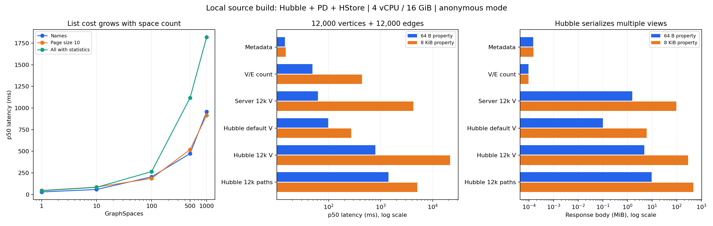
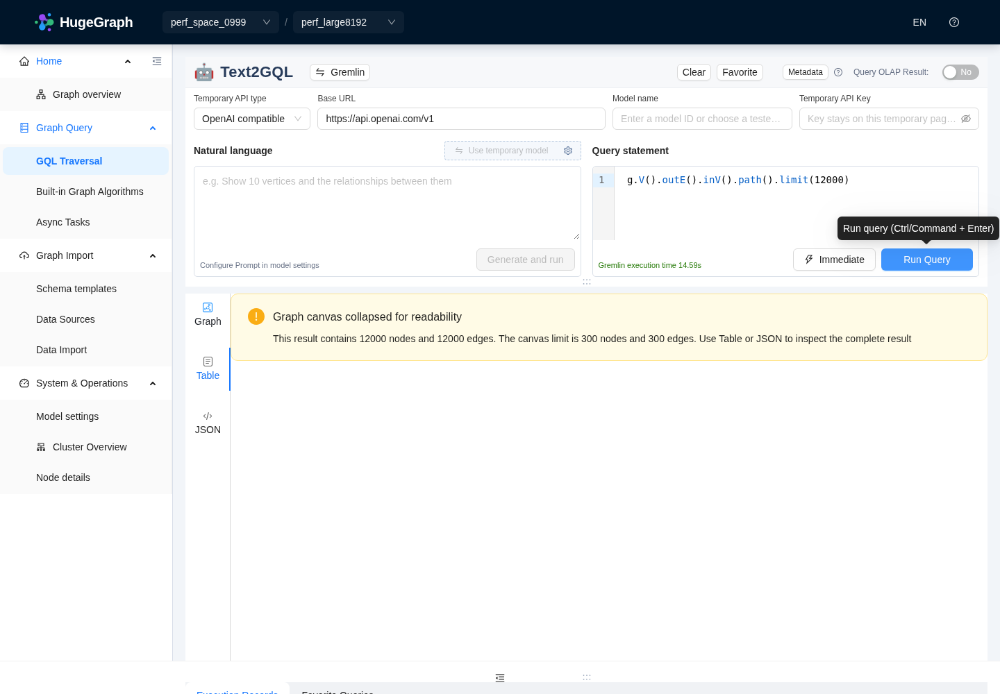

# Hubble + PD + HStore 本地源码性能实测（2026-10-22）

本地已复现列表请求放大和大属性结果加载开销。PD 的独立元数据 RPC 较快；主要问题是 Hubble 串行遍历、分页前计算统计/Schema、顶部切换器请求完整统计，以及查询结果同时构造多种视图。发现问题后未进入 Helm 阶段。基线阶段只新增报告、脚本和证据；后续首版优化与本地复测见 [优化对比](COMPARISON.md)，实施状态见 [TODO](TODO.md)。

后续已完成 [结合代码的完整根因分析与实施计划](ANALYSIS-PLAN.md)，包括耗时拆分、补查限额缺陷、Server/SDK 接口改法、分阶段交付和验收矩阵。

最终交叉审查还完成了共享解析与图构造前属性投影，以及默认不扫描、手动最多100000点/边、按实际Server和身份隔离的30分钟统计缓存。此前影响组的后端186项、前端同组合18组/401项和真实功能复核见[最终验证记录](VALIDATION.md#最终交叉审查与按需统计补充)。这些是后续功能验证，未重写下文基线或优化对比中的历史耗时；PD近似值与OLAP定期更新仍属后续计划。

最终元数据/任务就绪定向6组55项及生产构建通过；真实浏览器只查询选中图Schema并显示空Schema提示，表单测试验证此时不能进入下一步，见[补充验证](VALIDATION.md#元数据与任务就绪的最终定向验证)和[任务截图](screenshots/comparison/task-selected-schema-blocked.png)。这一轮及预检/分组键检查均为功能验收，不加入上述性能对照或186/401测试总数。

最新维护性复核的后端15类218项、前端12组272项已单次通过，生产构建亦通过，属于另一影响组，不与此前186/401或后续定向结果累加，也不代表前端全量重跑。统计缺失时隐藏空间卡片计数、缓存并发/身份隔离及仅按partial ID只读的修复见验证记录。

## 环境、构建与测试口径

同步Cypher的[实际Chrome验收](comparison/final-review-statistics/final-cypher-browser-check.json)确认请求携带预览标记，合成1MiB属性在页面显示截断提示，响应1135字节且页面异常为0，见[页面截图](screenshots/comparison/cypher-preview-browser.png)。截图中的API Key字段为空，属性片段为专门生成的测试数据；该查询未调用模型服务。

- 本机进程部署：1 PD + 1 Store + 1 Server（hstore 后端）+ 1 Hubble，单副本；没有使用 Docker 镜像或 Helm。
- cgroup 配额：4 vCPU、16 GiB RAM；Java 17.0.20.1。堆上限：PD 1 GiB、Store 2 GiB、Server/Hubble 各 3 GiB。
- Toolchain/Hubble：`37ea0b61d606abc0dc859b8a121815906df3c0aa`；Server/PD/Store 1.8.0：`86c05ef9c5d417bd37eab21d4ecd5af82bab17ef`。
- Hubble、PD、Store 本轮从源码构建成功；前端强制执行冻结依赖安装和 production 构建。Server 使用本地源码构建的分发产物，本轮重新 compile 后核对 dist/api/core/hstore 共 1011 个 class，与运行 JAR 字节完全一致。
- Server 使用默认匿名模式。这些结论不代替管理员、普通用户权限模式的实测；不同身份模式的列表实现不同。
- 串行请求、常驻服务；空间列表先预热 3 次，1/10/100 空间各 20 次，500/1000 各 10 次；`all=true` 5 次。数据接口预热 1 次，小结果测 10 次、大结果测 5 次。P95 使用最近秩法，5 次采样的 P95 等于最大值，不能当作稳定 SLA。
- API 计时包含响应下载，截止到 Python 收到完整 body，**不含客户端 JSON 解析/画布渲染**；体积为解码后的 body。浏览器另外计时，按页面实际出现的画布/表格状态判断可用。
- 请求链证据使用本地 HTTP 转发器和透明 gRPC 转发器。带跟踪的耗时含代理开销；独立去掉 HTTP 代理后另行复测。gRPC 跟踪只覆盖 Hubble 发往 PD 的发现流量，不覆盖 Server/Store 到 PD 的全部流量。
- 后续协议检查确认：Python 直连 REST 会协商 gzip，而 HTTP 跟踪代理剥离 Accept-Encoding。两条路径的耗时不能相减作为存储或 Hubble 的纯开销；[补充协议控制](protocol-control.json) 单独保留，不混入原有汇总。



## 图空间数量与列表开销

下表为空图为主的初始梯度，均为带 HTTP 跟踪的 P50 / P95（ms）。单个空间详情保持约 21–58 ms，主要退化发生在列表。

| 空间数 | Server 直接列名称 | Hubble 名称列表 | Hubble 每页 10 个 | Hubble 每页 1 个 | Hubble all=true |
| ---: | ---: | ---: | ---: | ---: | ---: |
| 1 | 1.8 / 4.6 | 30.4 / 38.3 | 47.6 / 63.8 | 49.3 / 72.7 | 44.2 / 66.7 |
| 10 | 1.2 / 5.9 | 58.7 / 66.3 | 86.2 / 115.5 | 49.2 / 72.5 | 84.0 / 106.1 |
| 100 | 0.8 / 1.2 | 204.8 / 305.6 | 186.9 / 266.2 | 153.3 / 208.0 | 265.3 / 301.0 |
| 500 | 0.8 / 2.1 | 474.4 / 594.1 | 519.5 / 554.0 | 487.1 / 750.2 | 1118.8 / 1192.7 |
| 1000 | 0.7 / 1.2 | 958.1 / 1022.3 | 916.5 / 1197.2 | 911.7 / 1062.0 | 1819.4 / 1999.8 |

1000 空间时，单次名称列表发出 **1004 次 Server HTTP + 1 次 PD 发现 RPC**；每页 10 个仍发出 **1018 次 Server HTTP + 1 次发现 RPC**，每页 1 个为 1009 次，`all=true` 为 2008 次。少数请求在认证模式缓存刷新时会多一次探测。
匿名路径先取名称，再用串行 `.map(getGraphSpace)` 获取全部空间详情，之后才筛选和分页。Server 空间详情又调用 PD `GetGraphSpace` 获取空间用量，并查询部门用户信息。缩小分页不能消除前面的全量读取。
初始梯度中 DEFAULT 最初有 1 张空图；100 空间阶段中途验证建图接口后多了一张空测试图，因此统计相关请求存在 2 次左右的常数差异。名称列表的 N+4 关系不受该夹具影响。

### 独立去 HTTP 代理复测

重启 Server，将 PD 中发现的 Server 地址改为实际监听的 `18080`，确认跟踪中不再出现 Server HTTP 转发。该阶段保留 1000 空间、50 张空元数据测试图、两张正式万级数据图及早期夹具，共 55 张图。

| 操作 | P50 ms | P95 ms | 次数 |
| --- | ---: | ---: | ---: |
| 空间名称列表 | 664.0 | 1042.1 | 10 |
| 每页 10 个空间 | 577.4 | 595.9 | 10 |
| 全部空间及统计 | 6922.3 | 7158.8 | 5 |
| 单图元数据（大属性图） | 8.2 | 15.5 | 10 |

这组是去跟踪后的独立复测，缓存/进程状态及图数据量与初始梯度不同，**不能把两组差值全部归因于代理**。`all=true` 的约 6.9 秒也不能与初始空图的 1.82 秒做纯代理比较。即使去掉代理，分页仍然读取全部空间。

### PD 独立 RPC 基线

完成其他请求后，以同一个 gRPC channel 预热 3 次、测量 30 次：

| PD 操作 | 返回空间数 | P50 ms | P95 ms |
| --- | ---: | ---: | ---: |
| GetGraphSpace(DEFAULT) | 1 | 0.4 | 0.8 |
| GetGraphSpace(空名称，取全部) | 1000 | 0.9 | 1.5 |

这支持“单次 PD 元数据操作较快、串行次数放大”的解释，不表示所有 PD 接口或真实网络条件都已验证。

## 同一空间内图数量增加

使用另一空间内的空图，以下均为带跟踪的独立 10 次请求。`/graphs/list` 返回图资料和统计，并非纯名称列表。

| 图数 | /graphs/list P50 / P95 ms | 每页 1 张 P50 / P95 ms | 每页 10 张 P50 / P95 ms | 单图元数据 P50 / P95 ms |
| ---: | ---: | ---: | ---: | ---: |
| 10 | 44.9 / 93.5 | 81.2 / 100.7 | 78.0 / 80.9 | 11.4 / 16.5 |
| 50 | 148.4 / 214.2 | 312.6 / 427.1 | 314.7 / 345.3 | 10.5 / 17.7 |

50 图、每页 1 张时仍发出 **405 次 Server HTTP**：3 次版本探测、2 次其他请求、50 次点扫描、50 次边扫描、300 次 Schema 请求。分页发生在所有图的统计和 Schema 汇总之后；单图元数据仍仅约 10.5 ms。1 图阶段与一次独立统计探测重叠，已在原始记录中标记排除，未用于本报告比较。

## 每图 12,000 点 + 12,000 边：64 B 与 8 KiB 属性

两个独立图都使用数字 ID 的有向环，每个点和边各有一个 `payload` 字段。内容按元素 ID 用 SHAKE256 生成确定性伪随机 Base64 文本，精确截到 64 或 8192 个 ASCII 字节，避免全是重复字符的压缩偏差。末尾通过 Hubble 再次校验，两图均为 12000 点、12000 边。

下表为带 HTTP 跟踪的 P50 / P95 ms；Server 直连 REST 行不经过跟踪代理。体积以 MiB 表示。

| 操作 | 64 B：P50 / P95 ms | 8 KiB：P50 / P95 ms | 64 B body MiB | 8 KiB body MiB |
| --- | ---: | ---: | ---: | ---: |
| Hubble 单图元数据 | 14.4 / 17.9 | 15.0 / 41.9 | 0.000 | 0.000 |
| Hubble 点边精确计数 | 48.7 / 57.3 | 439.3 / 554.3 | 0.000 | 0.000 |
| Server 250 点 | 13.8 / 20.7 | 252.1 / 290.9 | 0.032 | 1.970 |
| Server 250 边 | 13.6 / 21.7 | 240.8 / 286.7 | 0.049 | 1.987 |
| Server 12000 点 | 62.4 / 90.4 | 4262.7 / 4334.6 | 1.546 | 94.563 |
| Server 12000 边 | 91.2 / 123.4 | 4259.9 / 4307.9 | 2.372 | 95.390 |
| Hubble g.V()，默认 250 点 | 98.4 / 117.9 | 272.8 / 304.4 | 0.100 | 6.038 |
| Hubble g.V().limit(12000) | 790.8 / 1236.7 | 21569.0 / 21913.7 | 4.759 | 288.579 |
| Hubble 12000 条点边路径 | 1406.4 / 1482.8 | 5048.0 / 5462.7 | 9.548 | 474.636 |

路径查询为 `g.V().outE().inV().path().limit(12000)`，结果覆盖全部 12000 点和 12000 边。路径结果与单纯顶点结果的补查方式、序列化形态不同，不能用两行耗时比较某个单一后端算子的快慢。

关键观察：

- 大属性单图元数据仍约 15 ms（去 HTTP 代理后约 8.2 ms），并未随属性体积显著变慢。真正明显增加的是完整元素读出和结果构造。
- `g.V().limit(12000)` 产生 125 次 Server HTTP，其中 121 次为 Gremlin：1 次主查询 + 120 次每批 100 个顶点的关联边补查。达到边数量限制只跳出批次内循环，后续批次仍继续请求。
- 单顶点查询结果同时包含 JSON、Table、Graph 视图；大属性的 12000 点 body 达 302,597,361 字节，路径 body 达 497,691,767 字节。超过前端图形限制后，这些完整数据仍已生成和传输。
- PD 模式空间统计使用逐页读取完整元素的“小图统计”回退；超过 10000 个元素抛出限额异常并返回未知统计。大属性空间真实返回 `statistic={date:null,edge:null,vertex:null}`。这条路径不宜放在空间/图切换器的同步加载流程。
- 采样期间观察到的进程最大 RSS（并非同时峰值）：PD 790 MiB、Store 3823 MiB、Server 3801 MiB、Hubble 3507 MiB。没有观察到 cgroup OOM kill。RSS 不能简单相加当作同一时刻的峰值，也不等于 JVM 堆使用量。

## Chromium 实际页面

使用本轮 production 前端、系统 Chromium、1440×1000 窗口。以下是单次端到端观测，不是 P50/P95；网络、缓存、GC、浏览器解析会影响结果。

| 图 | 操作 | 完整响应接收 ms | 结果可用 ms | 最长主线程任务 ms | 实际显示 |
| --- | --- | ---: | ---: | ---: | --- |
| 64 B | 默认 g.V() | 707.5 | 1592.4 | 593.0 | 250 点画布（本环图中 16 条关联边） |
| 64 B | 12000 条路径 | 13854.6 | 14280.6 | 263.0 | 12000 行分页表格 |
| 8 KiB | 默认 g.V() | 474.6 | 1417.4 | 672.0 | 250 点画布（本环图中 16 条关联边） |
| 8 KiB | 12000 条路径 | 14634.1 | 15069.1 | 4420.0 | 12000 行分页表格 |

万级结果不能记为“万级画布渲染通过”：当前产品上限为 **300 点 / 300 边**，超过后自动切到表格，图形页明确显示 `12000 nodes and 12000 edges; canvas limit 300 / 300`。该保护已通过两组实际页面确认。默认画布已执行滚轮缩放；两组最终浏览器运行均无 pageerror。

1000 空间页面导航还会同时加载分页列表和顶部切换器的 `graphspaces?all=true`。最终查询页观测到切换器请求约 6–7 秒；不能把这部分等待归为画布绘制时间。大属性路径结果浏览器主线程出现约 4.42 秒长任务，即使最终只展示表格，也会有明显卡顿。



## 建议的改进顺序

1. 空间/图切换器使用轻量、受权限过滤的名称/ID/昵称接口，取消同步 `all=true` 统计和全图 Schema；统计按需或异步加载。
2. 空间详情批量获取；筛选、权限边界和分页在服务端正确执行后，再为当前页补充信息。不能仅缩小前端 page_size，也不能通过共享未分权限的缓存绕过授权。
3. 图列表先分页，再取当前页的 Schema/统计；减少重复读取同一图的 Schema。50 图每页 1 张却获取 300 次 Schema 是可直接回归验证的目标。
4. 关联边补查达到全局限额后停止后续批次；大属性按投影/详情懒加载，JSON/Table/Graph 按当前视图返回，或采用可控的分页结果协议，避免一次构造数百 MB 的多视图结果。
5. 空间总量优先采用可用的元数据/异步聚合统计；超过小图统计上限时避免反复拉取 11000 个完整大属性元素后才返回未知。
6. 修复并按相同矩阵回归本地版本后，再考虑官方 Helm。Helm 能改变拓扑和资源配置，不能自动消除这些串行调用与负载放大。

## 证据与复现

- [原始采样](samples.jsonl.gz)、[HTTP/gRPC 跟踪](trace.jsonl.gz)、[资源时间序列](resources.jsonl.gz)、[汇总 CSV](summary.csv)、[汇总 JSONL](summary.jsonl)。
- [版本与环境](provenance.json)、[PD 基线](pd-summary.jsonl)、[浏览器观测](browser.jsonl)、[最终点边数量](final-count-validation.json)、[未知空间统计](space-statistics-check.json)。
- [复现脚本](scripts/benchmark.py)、[点边生成及测试](scripts/data_benchmark.py)、[图数量测试](scripts/graphs_benchmark.py)、[浏览器测试](scripts/browser_benchmark.py)、[跟踪代理](scripts/trace_proxy.py)。脚本使用本次环境的 `/workspace/hubble-perf` 路径和端口；移到其他机器时需先调整这些路径。
- 服务保留在本地：Hubble `127.0.0.1:8088`、production 前端 `127.0.0.1:3000`、Server `127.0.0.1:18080`、PD REST/gRPC `8620/8686`、Store REST/gRPC `8520/8500`。Hubble 仍启用 PD 发现；最后已改为发现后直连 Server。
- 构建日志与运行工作目录保留在 `/workspace/hubble-perf/logs` 和 `/workspace/hubble-perf/runtime`。配置中的本地随机密钥未复制到报告目录。
- 早期夹具中还观察到“删除图后立即同名重建”导致 `Graph has been closed` 的 500；正式两组数据改用新的图名，重新生成伪随机属性并校验数量。该设置阶段失败没有混入正式接口耗时，尚不能认定其根因。
- 浏览器脚本最初等待万级画布，但实际页面已切表格；修正为验证原生表格和上限提示后重新执行。原先等待条件的超时不计为产品渲染失败。

保留的数据集可以直接重跑读取和浏览器测试（会追加本地采样/查询历史）：

```bash
cd /workspace/hugegraph-toolchain/docs/performance/2026-10-22-hubble-hstore/scripts
python3 data_benchmark.py run
python3 browser_benchmark.py
```

空间数量梯度需要只有 DEFAULT 的全新专用集群；图数量梯度需要空的专用空间，脚本会拒绝在已有数据上假标数量。导入脚本也拒绝覆盖已有同名图。运行依赖为 Python requests/hpack/grpcio/grpcio-tools/playwright/matplotlib，以及已构建的 Java 服务；PD 独立脚本使用工作目录中按源码 proto 生成的 Python 模块。

主要代码定位：
- [空间全量详情读取](../../../hugegraph-hubble/hubble-be/src/main/java/org/apache/hugegraph/service/space/GraphSpaceService.java#L288)。
- [图列表分页前计算 Schema](../../../hugegraph-hubble/hubble-be/src/main/java/org/apache/hugegraph/service/graphs/GraphsService.java#L141)。
- [顶部切换器 all=true](../../../hugegraph-hubble/hubble-fe/src/components/GraphContextSwitcher/index.js#L36)。
- [关联边分批查询](../../../hugegraph-hubble/hubble-be/src/main/java/org/apache/hugegraph/service/query/QueryService.java#L634)。
- [小图统计上限](../../../hugegraph-hubble/hubble-be/src/main/java/org/apache/hugegraph/service/graphs/GraphsService.java#L679)。
- [前端 300 点边限制](../../../hugegraph-hubble/hubble-fe/src/modules/analysis/QueryResult/Home/utils.js#L65)。
