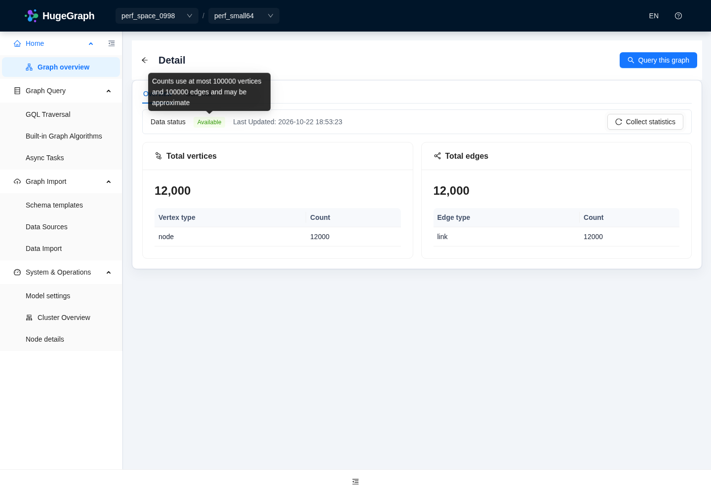

# 最终验证记录

前一轮本地集成源码为`1ea4a9bb7e150b3169a713473b0ccf81eac85bdb`；最终交叉审查与统计阶段见下一节。Java17；Node24.22.0 / pnpm12.14.0。Maven使用经过校验的候选SDK和独立缓存，未绕过外部输入门禁。前端生产构建包含i18n、TypeScript及Vite，最终文案修复后再次成功。

## 最终交叉审查与按需统计补充

首批交叉审查集成源码为`3e9d20fa55449b3efbb10130040be90eb16d4add`。这是后续功能回归，不重测或覆盖既有P50/P95。查询[#79](https://github.com/hugegraph/hugegraph-toolchain/pull/79)中，默认上限与预览复用同一语句解析规则，属性投影前移至图构造之前；转换图视图时跳过已投影点边属性，避免重复扣除共享预算。1000个顶点×10个属性使用同一个回归测试：临时移除该跳过逻辑后1项失败，恢复后同项通过，两次均未跳过测试；失败为原本完整属性被二次投影耗尽预算。只归档[摘要和日志SHA](comparison/final-review-statistics/validation-summary.json)，不提交原始构建日志。

列表[#78](https://github.com/hugegraph/hugegraph-toolchain/pull/78)进一步将核心元数据与统计/Schema分开。默认只读缓存或已有快照，无可用快照显示“未统计”，不启动点边扫描。用户手动收集时分别执行`g.V().limit(100000).groupCount().by(label)`和`g.E().limit(100000).groupCount().by(label)`；结果可能只是有界近似值。缓存以实际解析到的Server、授权身份、空间和图区分。用户后续明确缓存30分钟，已复用既有Guava依赖实现`maximumSize(1024)`与`expireAfterWrite(30m)`，并验证实际过期清理和容量驱逐；既有异步任务map保持原样，未再复用它做手动时间戳缓存。PD近似值及OLAP定期更新保留为后续事项，此轮未新建统计系统。

- 后端集成146项、补充28项，其中15项重叠，合计**159项不同测试**通过；统计阶段87项与上述测试有重叠，不另行累加。
- 前端同一最终组合**8组/224项**全部通过。最初2项新增交互测试发生`userEvent`超时，改用明确的`act`和`fireEvent`后同组合通过，没有提高超时。i18n、TypeScript和Vite生产构建通过。本机日志为`/workspace/stats-front-async-followup-tests.log`，不随报告上传。这组结果不把下文既有全量扫描改记为全绿。
- [查询8项实际API检查](comparison/final-review-statistics/cross-review-live-smoke.json)覆盖默认300、显式大limit、长整数/数字分隔符、终结toList、count及长路径；[大属性复核](comparison/final-review-statistics/large-property-cross-review.json)确认原值SHA不变；[最终Chrome默认300与切图](comparison/final-review-statistics/cross-review-browser-smoke.json)通过，页面异常0。
- [统计7次实际调用](comparison/final-review-statistics/statistics-live-smoke.json)覆盖图/空间核心信息、图分页、无快照、手动收集和缓存复用；[统计Chrome检查](comparison/final-review-statistics/statistics-browser-smoke.json)确认默认完整统计请求0次、手动1次。对真实Server统计响应施加受控延迟时，核心信息和导航仍可用，提示明确每类最多100000个元素，页面异常0。JSON里的单次耗时仅是功能检查记录，不能当作新的性能基准。

进一步跨模块复核：后端集成**185项**全部通过（`final-integrated-review-backend-tests.log`），前端同组合**18组/401项**全部通过（`final-integrated-review-frontend-confirmed.log`）。初次前端检查中，旧`getGraphData` mock缺少新增inline配置；补齐fixture和对应断言后通过，未放宽断言或测试超时。后续缓存30分钟及legacy Basic快照/手动缓存身份一致性定向检查分别21/23项通过，有重叠，不与集成数量相加。上述原始日志仅留本机，不上传报告。

最终30分钟缓存与ID wire修复后，集成**后端186/186、前端同组合18组/401项**全部通过，i18n、TypeScript及Vite生产构建通过；本机日志为`final-30min-wire-backend-tests.log`、`final-30min-wire-frontend-tests.log`与`final-30min-wire-build.log`。这组取代185项轮次作为最终集成数量，不与前述轮次累加。随后统计来源Tooltip仅在成功状态展示，未统计、错误和加载状态不声称已有快照；该小修另有6项定向测试及生产构建通过，亦不累加到401项。最终本地源码为`1bae746aff7684180d5f7a99bade7a9c400ae007`。

只读保护收敛到具体元素，完整属性仍可编辑。[最终HTTP wire检查](comparison/final-review-statistics/mixed-preview-wire.json)中2个顶点ID以及部分预览ID列表均为字符串，与实际SDK元素的JSON序列化一致；真实`JacksonConfig` serializer也有回归断言。此前运行目录中数字型ID的中间记录不代表最终wire。[混合预览Chrome](comparison/final-review-statistics/mixed-preview-browser.json)确认完整点Edit可用、裁剪点Edit禁用、页面异常0、PUT/PATCH请求0，原始属性SHA不变。

[真实普通repeat语句](comparison/final-review-statistics/common-traversal-live-smoke.json)`g.V().repeat(out()).times(2).path()`在Hubble实际执行返回300行并应用默认上限；单次响应耗时不是性能基准。

## 最后评论修复的定向复核

前端大结果预检进一步精简：仅排除写操作与明确终结的标量结果，不再因`aggregate`或`sideEffect`漏拦；Cypher包含`WITH`、`UNWIND`时的显式大`LIMIT`也会拦截。复杂或未知类型的Map键直接省略，沿用不完整标志，不调用`toString()`。

本轮Home及queryLimits定向**2组/156项**通过（`frontend-simple-preflight-final-tests.log`），QueryPropertyPreview定向**17项**通过（`element-preview-map-key-tests.log`）。这些是上述186项后端、18组401项前端影响组之后的独立定向结果，不累加成全量测试数量；本轮未重跑或改写历史性能实测。

## 元数据与任务就绪的最终定向验证

[#78](https://github.com/hugegraph/hugegraph-toolchain/pull/78)收敛了空图引导：GraphDetail只在记录数量为零时按需异步确认Schema，再决定空图引导；Card、NumberCard和GraphDetail复用`formatRecordedCount`，有界计数显示`≥`，近似计数显示`≈`。Task仅用既有Schema接口异步校验当前选中图，等待中、空Schema或读取失败均阻止进入Next，不对全图列表逐项读取Schema。合并后的**6组/55项**单次全部通过（74.723秒，`final-metadata-readiness-tests.log`），i18n、TypeScript和Vite生产构建通过（`final-metadata-readiness-build.log`）。

[实际Task浏览器检查](comparison/final-review-statistics/task-selected-schema-browser.json)仅发出1次选中图Schema GET，空Schema提示可见，mutation及页面异常均为0；等待或空Schema时提交不能推进的断言由上述AntD表单测试覆盖。[大结果预检Chrome](comparison/final-review-statistics/final-preflight-browser-smoke.json)中`aggregate`、`sideEffect`、终结`toList`三条显式大结果查询均为0 POST；`hasNext`仅1次POST并返回HTTP200，应用页面异常为0。Playwright关闭context时的`Target closed`辅助警告与应用`page_errors`分开记录。

[真实SDK分组键检查](comparison/final-review-statistics/final-group-key-live-smoke.json)在64/257字符属性的2点夹具上执行`g.V().groupCount().by(valueMap('payload'))`，HTTP200、响应699字节、`properties_truncated=true`，只保留1个短键（最长76字符）。该SDK将分组键暴露为文本，超过256字符的键被省略；结构或unknown键的1MiB场景另由17项单元测试覆盖，不将这条live检查称为1MiB分组实测。

这些均是后续功能验收，不是性能对照。此前186项后端、18组401项前端仍是原影响组记录；本轮55项与前述156项前端、17项后端定向结果分别记录，不混算为全量总数，也不改写历史benchmark。

## 多行Gremlin与Cypher预览的后续验收

[#79](https://github.com/hugegraph/hugegraph-toolchain/pull/79)后续评论修复了语句拆分的分隔符深度，格式化多行Gremlin不再被误拆；前端允许终结的小型全局`range`同步执行，Cypher非字面量`LIMIT`引导异步而不求值。同步Cypher与生成Cypher复用既有同一属性投影和三视图管线。

本轮集成定向后端**118项**、前端**3组/174项**及生产构建通过；解析器专项31项通过，反证旧splitter时27项中新增2项失败。它们与此前186项后端、18组401项前端及55/156/17项后续定向结果分别记录，不累加为全量总数。

[真实多行hstore查询](comparison/final-review-statistics/multiline-gremlin-live-final.json)验证默认300行及显式大结果预览1000行均通过。[同一1MiB Cypher标量](comparison/final-review-statistics/cypher-property-preview-live-final.json)单次功能对照的响应由2097713字节降至1135字节；原始读取仍为1048576字符，SHA与原夹具一致。该体积对照不是延迟benchmark；Cypher SDK仍先完整物化结果，不能据此宣称上游硬限制已完成。复杂或未知Map键仍直接省略并保留不完整标志。

## 缓存与只读保护的维护性复核

#78在空间卡片未提供统计时隐藏计数行，不新增请求。手动统计使用Guava `Cache.get`加载，避免不同key受segment锁阻塞，并保留原始`RuntimeException`；同一25项专项测试在旧源码反证中恰有1项并发测试失败，修复后25项通过。仅在PD自动发现成功时使用规范化peers与cluster加既有授权指纹的逻辑缓存身份，显式Server和非PD连接仍隔离；双HTTP版本端点真实夹具19项通过，额外PD调用为0。#79移除无实际发布版本支撑的全局partial回退，只按具体partial ID标注只读，截断Alert保留。

主合并后端**15类/218项**与前端**12组/272项**（96.438秒）单次全部通过，分别记录于`final-cache-scope-all-backend-tests.log`、`final-cache-scope-all-frontend-tests.log`。生产构建通过；重启最终编译版本后的真实浏览器确认默认完整统计请求0次、点击采集1次，真实Server响应受控延迟期间核心信息仍可操作，计数显示≈12000，提示包含100000上限、近似值和30分钟缓存，页面异常0。这与此前186项后端、18组401项前端及后续各轮定向结果分开记录，不累加为全量，也未重测或改写历史benchmark。

## 后端、浏览器及脚本

- 查询/投影：55项专项全部通过、Checkstyle0；最终逐行mapper/局部scope小修单独20项通过（有重叠，不累加）。异常/历史19项全部通过。
- 元数据服务/Controller相关测试通过；TopBar/API/查询上下文29项通过，含迟到Vermeer能力和过期响应。最终集成的GraphAnalysis上下文3项另行通过。
- Server Struct完整136项测试、格式及模块编译通过；压缩输出长度和SHA相同。
- 原匿名Chrome用例及独立PD认证管理员/普通成员Chrome实际登录、查询、空间/账号可见性、越权和注销通过，最终页面异常0。角色边界见[认证说明](comparison/final-followup/auth-verification.md)。
- 巨键SDK错误体HTTP400保持不变，最终消息2048字符、响应2121字节；原始属性SHA保持。局部归约/前序显式limit/全局count最后5项[真实API断言](comparison/final-local-reducer-smoke.json)通过。
- [脚本负向测试](scripts/test_evidence_scripts.py)6项通过（0.041秒）：拒连/短响应真实502、headers后失败不重复写状态、126秒终态轮询、超时非0、边缺失/身份/端点/内容不符必须失败。真实专用1MiB边身份/端点/长度/SHA校验也通过。运行：`python3 -m unittest discover -s docs/performance/2026-10-22-hubble-hstore/scripts -p test_evidence_scripts.py -v`。

## 前端完整扫描及失败项复核

固定Node24.22下执行全量Jest（2workers）完成210组/2064项，耗时416.109秒：207组、2056项通过；3组、8项失败。这不是一次全绿运行。

- 4项文案失败来自本次新增提示中的句号，违反仓库既有简洁文案约束；仅修改中英文提示，不改测试白名单。标点约束及查询相关4组/170项随后全部通过（9.491秒），i18n和生产构建通过。
- 其余4项为未修改Graph编辑页面的5秒/10秒测试超时。固定Node24.22隔离2组结果25/26通过；仍超时的示例导入用例再单独执行以4.391秒通过，保留原5秒门限。所有原失败用例最终都在定向重跑中通过，但不将这些分次结果表述为单次全量全绿。
- 先前与认证夹具启动并行的一次runInBand全量在300秒处中止；inspector实际栈定位到未修改ImageView的jsdom/AntD样式计算，不能仅根据测试排序认定首个测试或查询保护发生死循环。ImageView及TaskEdit/Schema三组隔离48项通过；该观测不属于产品性能采样。

完整日志保留在本机`/workspace/hubble-perf/logs`，包括`optimized-frontend-full-two-workers.log`、`frontend-copy-punctuation-query-tests.log`、`frontend-isolated-graph-pinned-node-tests.log`、`frontend-graph-example-case-isolated.log`。没有为获取通过结果提高测试超时，也没有修改无关页面业务代码。

## GitHub CI

以各PR当前Checks为准，本地结果不代替远端CI。Server本轮Struct、PD、HStore、RocksDB、内存后端、cluster及license检查已通过；Store Arthas交互检查曾因版本输出与prompt同一行而被既有正则误判。该fixture不加载Struct/BytesBuffer，仅失败job重跑一次，其余成功job不重复。Toolchain的最新提交会重新触发CI；未将排队/进行中的检查标记为成功。
