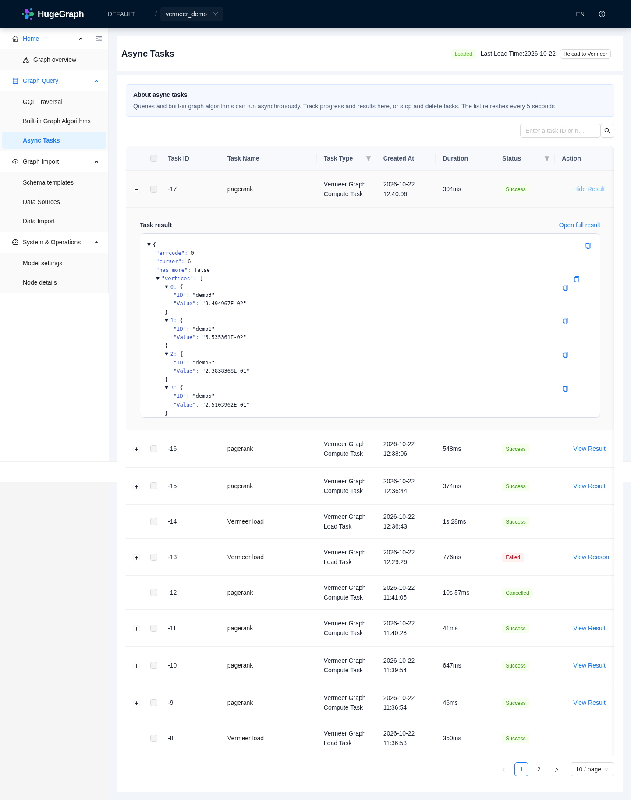
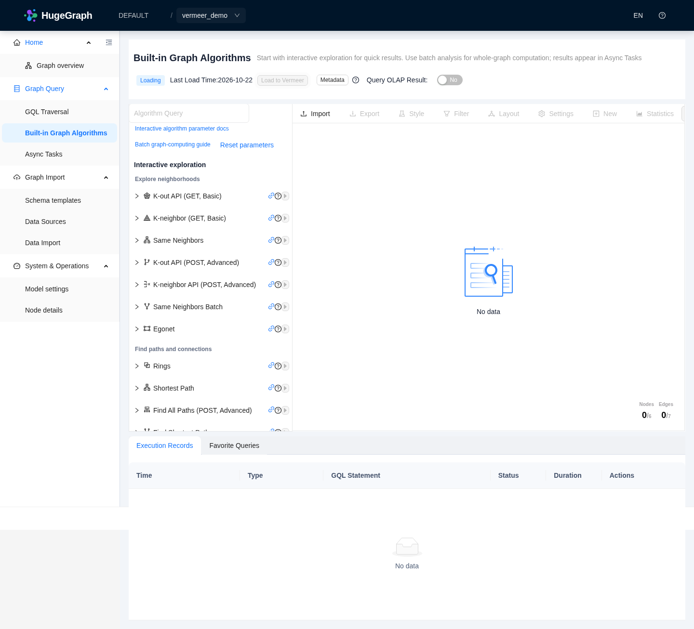
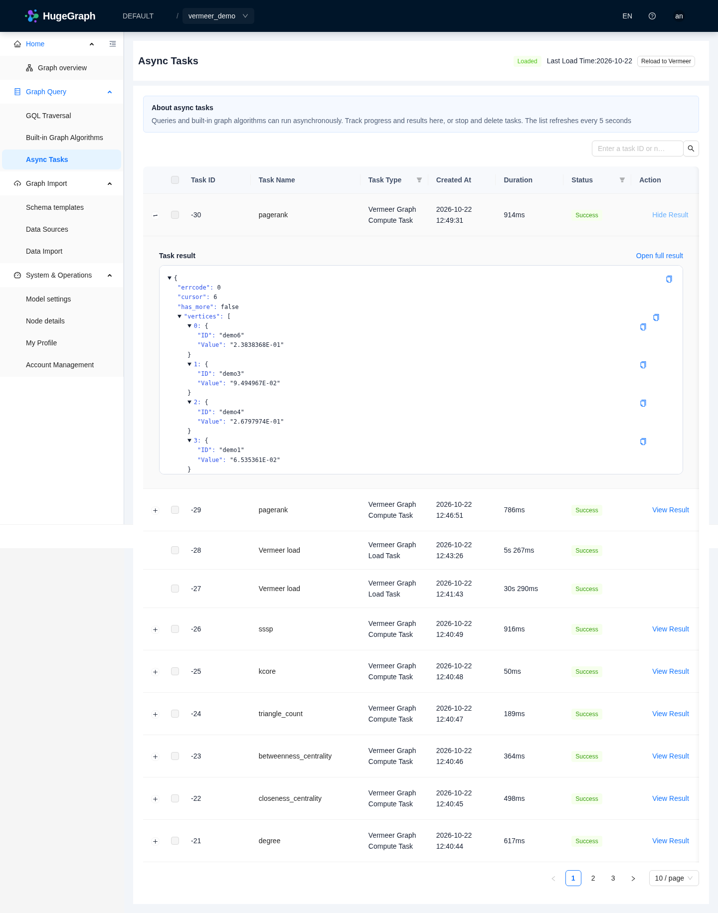
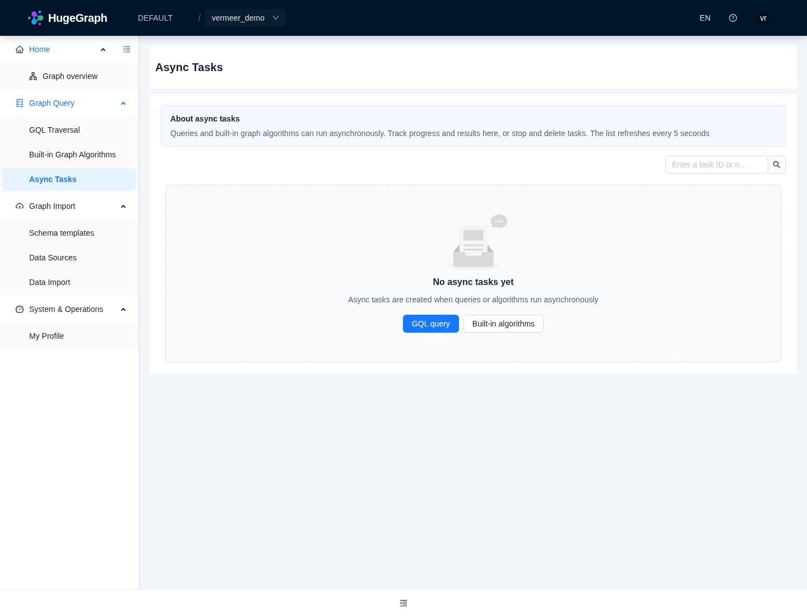
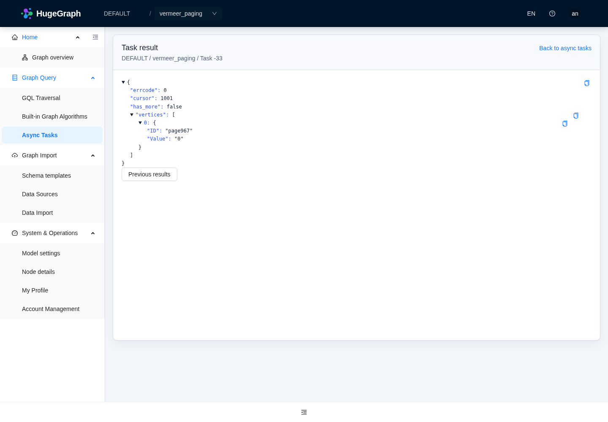
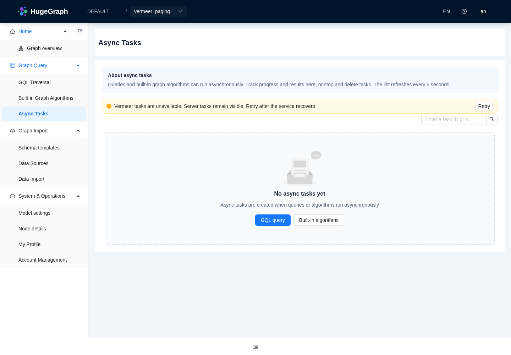

# Hubble and Vermeer development environment

This environment runs Hubble against the Go module in
`/workspace/hugegraph-computer/vermeer`. It retains editable source, the Go build
cache, and a development binary. The Java Computer/Kubernetes stack is not needed
for this workflow.

The prepared components are Go 1.23.7, JDK 17, the existing candidate HugeGraph SDK
at `86c05ef9c5d417bd37eab21d4ecd5af82bab17ef`, and separately running PD, Store,
Server, Vermeer Master/Worker, and Hubble. The development helper pins all three
database images by digest. The helper expects `hugegraph/hugegraph-computer` at
`819b34de39bf4c0e26b88b3465d7835f67a5aea9` ([Computer PR #19](https://github.com/hugegraph/hugegraph-computer/pull/19)); local edits are retained when refreshing
the environment. Earlier retained-stack evidence below was collected at
`b5c1693f27779aeefc0098833368fbfc5448d544`; the newer discovery and load-send changes
have focused unit validation, without a new live-stack run.

Reuse the prepared checkout and toolchains above. Initial source/toolchain setup
is outside this helper: `prepare` checks the existing Computer directory and Go
binary, writes integration configuration and builds. It does not clone or reset
source, install Go, or pre-pull images. `start` reuses existing containers; Docker
may pull the pinned image when creating a missing container.
Deployment credential files require trusted `pd_peers` on both Master and Worker.
The helper writes the local PD endpoint into both generated INI files; refresh
existing configuration before using the newer Vermeer revision.
Retained process IDs are accepted only when the full expected component command
matches, including this environment's configuration paths. A mismatch stops the
operation for inspection; it does not signal that process.

Run these commands from `/workspace/hugegraph-toolchain`:

```bash
# Refresh/build the retained environment after the base Java/frontend install.
python3 hugegraph-hubble/hubble-dist/assembly/travis/vermeer_dev.py prepare

# Start services and verify API access and Worker registration.
python3 hugegraph-hubble/hubble-dist/assembly/travis/vermeer_dev.py start

# Seed a dedicated graph, load it, run PageRank, and verify values and task filters.
python3 hugegraph-hubble/hubble-dist/assembly/travis/vermeer_dev.py smoke
```

The smoke test uses `DEFAULT/vermeer_demo`: six vertices and seven directed edges.
It creates the graph through the Server API so its configuration and schema are
available to Store via PD. It can be repeated; it reloads an existing Vermeer graph.
The fixture is separate from the default `hugegraph` graph. Do not change a live
cluster's metadata namespace while reusing its data; old schema IDs can make raw
Store scans fail even when another graph's REST requests work.

After Go edits:

```bash
source /workspace/.onboarding/vermeer-env.sh
cd /workspace/hugegraph-computer/vermeer
go test ./apps/common -run TestPDAuthority -count=1
cd /workspace/hugegraph-toolchain
python3 hugegraph-hubble/hubble-dist/assembly/travis/vermeer_dev.py build --component vermeer
python3 hugegraph-hubble/hubble-dist/assembly/travis/vermeer_dev.py stop --component vermeer
python3 hugegraph-hubble/hubble-dist/assembly/travis/vermeer_dev.py start
python3 hugegraph-hubble/hubble-dist/assembly/travis/vermeer_dev.py smoke
```

For Java edits use `build --component hubble`, then `stop --component hubble` and
`start`. The helper uses the existing Maven wrapper, isolated candidate SDK
repository, and `sdk.validation.mode=candidate`; it does not substitute released
SDK artifacts. The Go development build uses `-tags=dev`, so embedded Vermeer UI
asset generation is unnecessary for Hubble/API integration.

Activate the frontend with `source /workspace/.onboarding/frontend-env.sh`, then
run `pnpm dev` from `hugegraph-hubble/hubble-fe`. Its API proxy targets Hubble on
port 8088. In Hubble select `DEFAULT` and `vermeer_demo`, switch to batch analysis,
load/reload into Vermeer, and run PageRank. Open the async task's result to inspect
the vertex values. The verification artifacts are under
`/workspace/.onboarding/integration/`.



Live processes do not survive environment publication. Run `start` again in each
restored environment; rerun `smoke` to produce current queryable computation
results. Master/Worker in-memory result caches are temporary. Database data,
Vermeer metadata, and local output files are retained, but historical task status
alone does not guarantee its in-memory query results remain available.

## Local development credentials

This Linux/POSIX helper is for a trusted single-user development environment with
trusted parent directories. It creates one random PD service secret, not a Hubble
user password, at `integration/pd-password` under `VERMEER_DEV_HOME`. The secret is
persisted and reused by later `prepare`/`start` calls and process restarts; `stop`
does not remove credentials. Removal or rotation requires deliberate coordination
with the dependent development services.

The managed runtime directories use mode `0700`; generated credential files use
`0600` before any write, including replacement contents. Symlinks and unsafe file
types/ownership are rejected. An existing tools/cache home is checked for ownership
and group/other write access without recursively changing its contents. Parent
directories and the current user remain part of the trusted boundary.

If `VERMEER_PD_PASSWORD_FILE` is supplied, it must already be a current-user-owned
regular file, without a final symlink, with mode `0400` or `0600` and one nonempty
UTF-8 line. The helper validates the opened file before reading it, and neither
creates nor changes permissions on this external file. Unsafe inputs are rejected.

PD and Server consume generated `pd.env` and `server.env` through Docker's
`--env-file` interface. These are intentionally plaintext runtime inputs, and
Docker administrators can inspect container configuration. File permissions are
not encryption and do not establish protection from the same user, root or Docker
administrators. Use development-only values; never supply or commit production
credentials. The CodeQL context remains subject to separate review.

The default home is outside the repository. For an in-repository home, use the
ignored `.vermeer-dev/` directory. Generated `integration/pd-password`, `pd.env`
and `server.env` are also ignored under other custom homes; arbitrary external
credential filenames are not covered by these rules and should stay outside Git.

## Connection and task contracts

Set `vermeer.url` in Hubble's properties to the Master HTTP origin. If Master uses
token authentication, put its separate service token in a protected file and set
`vermeer.token_file`. Hubble does not reuse its HugeGraph login token for Vermeer.
In Vermeer `auth=token` mode, HugeGraph load/reload requires this service token to
belong to a Vermeer administrator. The HugeGraph administrator who signs in to
Hubble and the Vermeer service identity are checked separately. A valid token for
an ordinary Vermeer user can pass worker readiness but cannot load HugeGraph data.
Hubble reports this specific rejection as a `vermeer.token_file` configuration
error; changing the Hubble user's login does not change that service token.
An empty `vermeer.url` retains the existing Dashboard/Server-proxy path and its
token-output capability restriction.
The native adapter requires `pd.enabled=true` because its loader reads PD/Store
partitions. Standalone Server deployments keep native load/compute disabled.
A missing readiness endpoint (HTTP 404) reports a Vermeer version or URL
configuration error. Correct the endpoint and retry manually.

The direct adapter uses the routes implemented by Vermeer:

| Operation | Vermeer route |
| --- | --- |
| Load/compute | `POST /api/v1/tasks/create` |
| Task status | `GET /api/v1/task/{id}` |
| Result values | `GET /api/v1/tasks/value/{id}?cursor=0&limit=1000` |
| Graph status | `GET /api/v1/graphs` |
| Space worker readiness | `GET /api/v1/workers/availability` |
| Cancel | `GET /api/v1/task/cancel/{id}` |

Hubble's graph name is encoded as `graphspace-graph` within the configured Vermeer
service space. Direct task IDs are negative in Hubble; native Vermeer IDs remain
positive. Readiness follows the authenticated service space's worker allocations
and common worker pool; unrelated registered workers do not enable the adapter.
Server task IDs retain their original meaning. All direct task and
result operations check the selected graph. Because raw Store scans bypass
Server's per-label permissions, authenticated direct access requires a HugeGraph
super administrator; anonymous mode follows the Server's anonymous graph access.
With direct integration configured, source graph deletion first checks for a
Vermeer copy. Removing an existing copy requires the same administrator permission;
missing permission or a cleanup failure reported by the native HTTP API stops
source deletion even when compute is unavailable. A successful HTTP response does
not verify every Worker acknowledgement or removal of saved files; those remain
native deletion limitations. Graphs without a copy retain Server's original
deletion permissions.

GraphSpace deletion checks the queue once for all exact Server member graph names
before unloading any copy, changing administrator bindings or deleting the source space. Accepted
native load/reload tasks must finish or be cancelled before source deletion;
failure to verify the task queue also prevents deletion. These checks do not
provide an atomic transaction against concurrent new submissions.
An HTTP failure during a later unload can still leave earlier copies unloaded;
the source space and its administrator bindings are retained in that case.

The Hubble direct adapter supports the nine algorithms shown by its Vermeer
forms. Results are queried through the task API and are not written back to
HugeGraph properties. The task result view returns up to 1000 values with a
cursor; additional pages are available at Hubble's
`GET /api/v1.3/graphspaces/{space}/graphs/{graph}/async-tasks/{negative-id}/values?cursor=N&limit=1000`.
Hubble provides next/previous controls for these result pages. Native Vermeer does not expose task-history deletion, so Hubble disables that action for direct tasks.
Query values are temporary; successful task history remains readable after their
cache expires. Local output uses a safe per-graph basename and truncates its part
files on repeated computations, rather than accumulating files for every run.
The native task-history API currently has no cursor or offset. Hubble reads up to
10,000 native tasks before applying graph filters; older records outside that
window are not included in the displayed total. Extending history beyond that
window requires coordinated native API pagination.

PD, Store and Server use the metadata cluster name `hg`. Both Vermeer processes
read PD's shared secret from `VERMEER_PD_PASSWORD_FILE` or `pd_password_file`,
outside task parameters. For an authenticated Server, also set
`VERMEER_HUGEGRAPH_CREDENTIALS_FILE` (or Worker config `hugegraph_credentials_file`)
to a protected JSON file containing a dedicated Schema reader's `username` and
`password`. This deployment identity needs Schema read access to the selected
graph; Hubble does not copy the caller's login into task history. An explicitly
configured unreadable or malformed credential file fails the load. The helper
generates a private PD deployment file once
and reuses it. It also allocates Worker group `default` to service space
`$DEFAULT`; without that allocation submitted tasks remain queued.

## Retained configuration

Environment variables may set `VERMEER_SOURCE_DIR`, `VERMEER_URL`,
`VERMEER_PD_PASSWORD_FILE`, `VERMEER_GRAPH`, `GOPATH`, `GOMODCACHE`, and `GOCACHE`.
The helper defaults to paths under `/workspace/.onboarding`. Go module checksum
verification and the existing SDK provenance checks remain enabled. Toolchain
installation and network policy belong to environment setup, outside this helper.


## Browser verification

After starting the frontend, run the checked-in browser acceptance script with
an installed Chromium (or omit the executable path to use Playwright's browser):

```bash
source /workspace/.onboarding/frontend-env.sh
BROWSER_EXECUTABLE_PATH=/usr/bin/chromium \
  node hugegraph-hubble/hubble-dist/assembly/travis/vermeer_browser_smoke.cjs
```

The script checks actual PageRank submission, terminal task state, result values,
graph switching and account visibility. It expects the six-vertex `vermeer_demo`
fixture and writes screenshots plus a JSON report under
`/tmp/vermeer-browser-evidence` (override with `VERMEER_BROWSER_ARTIFACTS`).
For a deliberate slow-load check on this dedicated development Worker, set
`VERMEER_WORKER_PID_FILE` to its PID file. The script pauses that Worker for
4.5 seconds and always resumes it in `finally`; never use this option against a
shared deployment.

To verify a separately prepared authenticated fixture, set
`VERMEER_TEST_CREDENTIALS` to a protected JSON file containing `username`,
`password`, `observer` and `observer_password`. The observer must have graph read
access. The script signs both users in through the UI, checks that only the
administrator can use direct Vermeer, verifies that the observer's Server task
list remains usable, and checks rejection of a direct compute request. It does
not create accounts or change permissions.

Recorded verification uses the rebuilt local services, with no mocked API
responses: all nine supported algorithms returned six vertex values; Chrome
verified anonymous/admin/observer flows and a delayed Worker load. The final complete Hubble backend suite passed 882 tests, including the direct
Vermeer permission and task regressions. The focused
frontend suites, lint, i18n, TypeScript and production build passed. The separate
Go regression includes deterministic storage-initialization failure and retry.
The page rechecks temporarily unavailable direct integration as services start,
and retains an accepted load task when switching away from a graph and back.
Result pagination peeks ahead so an exactly full final page has no extra next page.








Authenticated fresh-load verification used a separate observer identity for
Worker Schema reads. A dedicated 1001-vertex graph loaded through PD/Store;
its degree results returned 1000 values then one distinct value, and Chromium
verified both next and previous page controls without page errors.



Stopping the local Master also verified that the task page retains Server tasks
and displays a retryable warning, including when the Server task list is empty.


